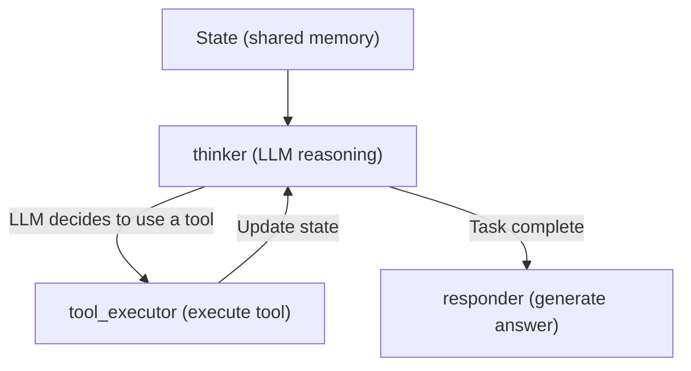
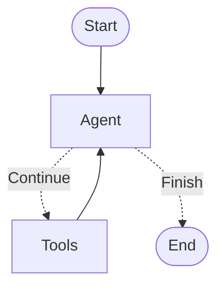
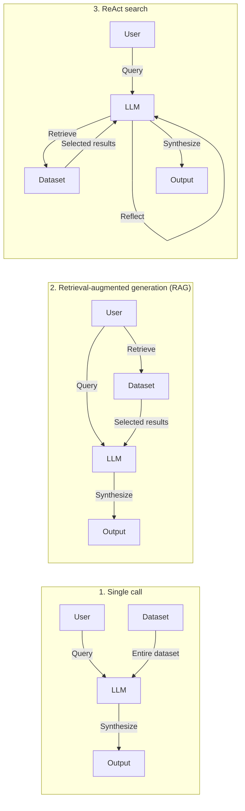
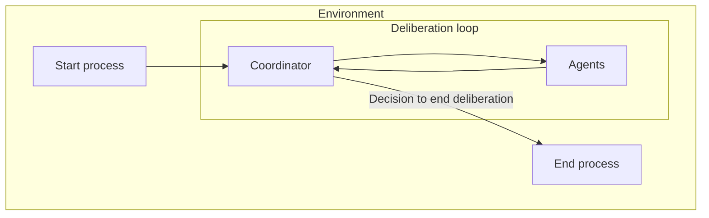

# Chapter 9. Social Simulation with Large Language Model Agents

> **Course edition.** English translation of Chapter 9 from the Chinese textbook proof. Chapter numbers and demonstration results follow the proof. The [English course notebook](../notebooks/prospect_theory_experiment_en.ipynb) is a separate runnable version of the rescue-operation exercise.
>
> The code listings follow the textbook example, with translated prompts and minor typesetting repairs. They include configuration placeholders. The book’s rescue example uses the roles and settings shown in the chapter.

## 9.1 Chapter roadmap

The randomized controlled trials discussed in the previous chapter can be understood as a kind of simulation. Researchers observe how predefined interventions affect participants’ behavior in constructed settings that retain some real-world features. Social simulation is a broader research method. Researchers specify rules and conditions in virtual environments to recreate interactions among individuals and groups in real-world settings. This lets them test theories, explain mechanisms, and analyze complexity, with applications to policy evaluation, scenario forecasting, and risk analysis. Social simulation has a long history. Advances in computing made it a systematic and widely used method. Common approaches include agent-based simulations built around individual interactions, system dynamics simulations built around feedback, and statistical simulations that use probabilistic methods.

Traditionally, social simulation has depended heavily on rules and parameters set in advance. The resulting behavior of simulated actors, or agents, was relatively simple.[^agents] Large language models (LLMs) have opened up new possibilities. LLM-driven agents can approximate human language comprehension, reasoning, and decision-making, allowing them to act and interact in complex, open-ended settings. These linguistic and cognitive abilities let researchers recreate more realistic social behavior and interaction in virtual societies and explore mechanisms such as emotions, cognitive biases, and identity, which are hard to capture with simple rules. By modeling aspects of social actors’ mental processes alongside structures and rules, social simulation can offer social scientists a more realistic tool for experimentation and theory testing.

The application of large language models in social simulation primarily relies on agents driven by large language models (LLM-driven agents). This chapter aims to introduce the basic cognitive framework of agents and discuss how to utilize the capabilities of agents beyond those of basic large language models in social simulation. The learning roadmap for this chapter is as follows:

- In the second section, we will study the cognitive architecture of individual agents, delving into the core components that make up an agent. This includes the mechanisms of reasoning (such as the chain of thought), action (utilization of tools), and decision-making (ReAct paradigm).

- In the third section, we will build an ReAct search agent. Through a hands-on example, we will learn how to use the LangGraph framework to transform the theoretical knowledge learned in the previous section into an agent capable of external information retrieval.

- Section Four explores the expansion from single agents to multiple agents. We will return to the "rescue operation" experiment, expanding the experimental scenario from independent decision-making to collective decision-making. This provides an opportunity for "learning while doing," allowing us to learn how to build a multi-agent system to accomplish social simulations based on research tasks and objectives.

- Section five explores the evaluation, verification, and ethical issues related to agent-based social simulations. It addresses how to assess the effectiveness of simulation results and the ethical challenges faced when using this powerful technology in research.

## 9.2 The cognitive architecture of an individual agent

To use large language models for social simulation, we first need to create agents based on the research tasks at hand. In the field of artificial intelligence, an agent typically refers to a computational entity that can perceive, make decisions, and take actions in a specific environment. It obtains environmental information through "sensors," processes it through internal mechanisms, and then affects the environment through "executors" to achieve predetermined goals or tasks. An agent driven by a large language model is an autonomous system whose "brain" is a large language model. It can not only understand complex information, make reasoning and decisions, but also actively plan steps, invoke tools, interact with the environment or others, and continuously adjust its behavior based on feedback. In simple terms, if the large language model is responsible for "thinking," then the agent is a complete system that can not only "think," but also act, collaborate, and make corrections on its own.

### 9.2.1 From large language models to agents: From static responses to dynamic interaction

#### (1) The limits of a single model call: The college entrance exam essay

As described in Chapter 3, the current powerful generative large language models operate based on probabilistic autoregressive generation. This approach is particularly effective when dealing with single, well-defined tasks. It can be vividly compared to writing an “exam essay”: the model receives a topic (prompt), and then proceeds word by word, starting from the first word on the paper, until the last word is generated. This process is linear, one-way, and irreversible. The goal of this one-way generation process is to maintain the fluency, relevance, and internal logical consistency of the text.

Complex reasoning and decision-making in the real world more closely resemble writing a research paper. The work proceeds in multiple steps, with repeated deliberation and feedback. An overall research plan guides the writing, yet the work seldom proceeds in order from the first line of the introduction to the last line of the conclusion. Chapter 2 emphasizes that social science research is nonlinear and iterative. The way researchers write reflects that process. Consider how a research paper takes shape.

- Interaction and Exploration: Writing is not a closed, monologal process. Researchers often begin with empirical data and engage in continuous “dialogue” with the data, thereby discovering patterns within it.

- Dynamic adjustment: Based on the results of data analysis, the theoretical framework and research hypotheses are revised or even redefined accordingly.

- Nonlinear writing: As mentioned in the beginning of the paper, the introduction section is often not written first. Instead, it is likely to be written later, after all the other sections have been completed. At that point, the introduction serves as a overall overview of the entire paper.

This process requires continuous verification, reflection, and interaction with external sources of information, such as literature, experimental data, and survey results. The mechanism of single calls and word-by-word predictions, typical of high-school entrance examination-style essays, is insufficient for such complex, non-linear exploration processes. Additionally, when writing in a closed environment, it becomes impossible to verify one’s hypotheses based on new external information, nor is there an opportunity to actively obtain external data to update one’s knowledge. Whether it’s humans or large language models, they often suffer from “factual hallucinations” under such limitations—that is, they write content that sounds reasonable but is actually incorrect. This represents a fundamental obstacle to the rigor that academia strives for.

#### (2) From large language models to agent-based systems

In order to break through the limitations of single-instance reasoning, the field of artificial intelligence is undergoing a paradigm shift from simple "generative AI" to "agentic AI". The core idea of this transformation is that large language models should no longer be seen as mere generators for generating text, but rather as a "brain" or central controller, embedded within a more comprehensive cognitive framework. In this framework, the large language model acts as a central processing unit, responsible for logical reasoning and decision-making. However, it no longer exists in isolation. By being connected to a series of external modules, the large language model is given the ability to interact with the external world. This combination of "large language model + external modules" has led to the emergence of LLM-based agent systems. These systems combine the general reasoning capabilities of large language models with the following key interaction capabilities:

- Perception: Breaking through closed environments, actively receiving new multimodal information and real-time feedback from external sources such as the internet, sensors, and user behaviors.

- Actions: Utilize external tools such as search engines, API interfaces, databases, and code interpreters to modify the environment or obtain specific data.

- Reflection: During the interaction process, experience is accumulated (memorized). Before taking action, multiple steps are planned. After the action is carried out, self-correction and summarization occur, thereby guiding future decisions.

This systematic integration transforms a static text generator into a dynamic problem solver, capable of autonomously planning and executing tasks to achieve specific goals. To achieve this transformation, the key task is to build a “cognitive architecture” for the large language model. Just as the human brain needs to work in conjunction with senses, muscles, and the hippocampus (memory) to function, a cognitive architecture is an organic system composed of multiple core modules: memory, tools, planning, and execution. These modules work together to endow the agent with the ability to perceive the environment, take actions using tools, and continuously adapt and evolve based on feedback.

#### (3) Agents: Reasoning and action

The most crucial ability of an agent is reasoning. Reasoning ability is the cognitive foundation of all advanced functions of an agent, much like an "inner monologue," allowing the agent to deliberate and infer within the scope of existing knowledge. It breaks down complex problems into multiple logical steps, analyzes each step systematically, and generates solutions in a structured manner. Research on large language models has long shown that the standard "input-output" prompt pattern is very ineffective when dealing with tasks that require multiple logical or mathematical steps. Models tend to provide answers directly, and these answers are often based on statistical patterns rather than rigorous logical reasoning, resulting in a high error rate. However, the reasoning mechanism of agents often uses the chain of thought technique introduced in Chapter 4 to break down complex problems into a series of logically rigorous intermediate steps. By analyzing each step systematically, agents can self-plan and reflect, thereby significantly increasing their success rate in solving complex problems.

However, an agent that can only reason within its own internal knowledge base is like a theorist locked in a library: knowledgeable and capable of speculative thinking, but with static knowledge that cannot perceive or influence the external world. If we want agents to be able to interact with the dynamic external world, this ability must be obtained through the tool calls introduced in Chapter 4.

The fundamental principle of a large language model is text generation. Without the invocation of tools, it cannot browse web pages, perform calculations, or access real-time databases. Tool invocation is an architectural pattern that allows the large language model to call external functions or APIs, thereby breaking through the fundamental limitations of the model. This process does not involve the large language model directly executing code; instead, it is a tightly controlled collaborative process consisting of three steps:

- The first step is intent recognition and function selection: When faced with tasks that cannot be completed solely based on internal knowledge (for example, "Who is the winner of the 2023 Nobel Prize in Economics?"), the large language model analyzes the instructions and determines whether it is necessary to invoke tools from a predefined list of tools, as well as choosing which tool to use.

- Step two: Generate structured instructions: The large language model does not execute the tool itself. Instead, it generates a structured data object (usually in JSON format), which includes the name of the tool it wishes to call, as well as the parameters required to complete the task. For example: { "tool": "web_search", "parameters": { "query": "Nobel laureates in economics in 2023" } }

- In the third step, external execution and result return: The application code that utilizes the large language model receives this JSON object, parses and verifies it, and then safely executes the corresponding functions in its own environment (such as calling the search engine API). The result obtained after the application execution ("Claudia Golding was awarded for her research on the outcomes of the female labor market") is returned to the large language model, updating its context.

Through these three steps, a large language model can utilize information from the external world to generate more accurate final answers.

The set of all tools that an agent can use is called the "action set". For social scientists, the design of the action set is one of the core aspects of agent design. It defines the capabilities of the agent and profoundly influences its behavior patterns. An agent designed for social scientific research typically includes the following tools in its action set:

- Academic search engine: Used for conducting literature reviews (for example, calling the Semantic Scholar API).

- General-purpose web browsers: Used for accessing news reports, government documents, and non-academic background information.

- Data Analysis Module: A sandbox-based code execution environment (usually written in Python), used for performing statistical tests, processing datasets, or generating data visualization charts.

- Geographic Information System (GIS) tools: Used for analyzing geospatial data, such as calculating geographic distances or determining regional densities.

- Quantitative model solver: Used to solve specific economic games or social dynamics models.

A carefully designed action set is crucial for ensuring that an agent's behavior is both powerful and controllable. In agent design, the action set is not just a simple technical setting; it fundamentally defines how the agent participates in interactions, makes choices, and influences overall outcomes. This is because the tools given to an agent directly determine its "behavioral possibilities." For example, when simulating the formation of public opinion, an agent that can only access "historical news databases" and an agent that can access "real-time social media" may produce vastly different outcomes. Therefore, researchers must carefully select and justify the design of the action set, just as they would with sampling methods or questionnaire design. An overly broad or vaguely defined action set can lead to confusion in the agent's choice of tools, or it may result in unexpected actions. Conversely, a task-oriented and clearly defined action set can more reliably guide the agent toward the desired research objectives. This approach of controlling through a strict definition of action capabilities is the foundation for building responsible and trustworthy scientific agents. The strategic evolution from large language model APIs to agent ecosystems by leading AI providers such as OpenAI clearly reflects the industry trend of moving from providing pure language models to building complete agent ecosystems. Initially, the core products offered by these companies were "model as a service," allowing developers to leverage their powerful reasoning capabilities through interfaces like Chat Completions API. However, the industry quickly realized that to solve complex problems in the real world, reasoning capabilities alone were insufficient. Therefore, agents are seen as the next major growth area in the field of artificial intelligence. To drive this transformation, companies like OpenAI began providing integrated, built-in tools that directly empower the construction of agents. For example, they introduced:

- Web Search Tool: Enables agents to access real-time internet information.

- Computer Use Tool: This allows agents to directly operate computer applications through a graphical user interface (GUI), greatly expanding their capabilities. This enables them to interact with legacy systems that do not have APIs. At the same time, the underlying APIs are also evolving. In March 2025, OpenAI replaced the old Chat Completions API with the new Responses API. This API natively supports multi-turn dialogues and complex tool calls, which are essential requirements for agent design. Subsequently, the Assistants API was officially discontinued in August 2026. The Responses API gradually integrated built-in tools such as file search and code interpreters, becoming the unified entry point for OpenAI to build agent-based applications. This shift from providing a “brain” (large language model) to providing both “hands and feet” (integrated tools) and a “nervous system” (dedicated APIs) marks an important industry consensus: Future competitive advantages will not come solely from the power of basic models, but also from how these models and tools are effectively orchestrated to create reliable and secure modular agent systems. For researchers and developers, this means that the focus shifts from simple “prompt engineering” to more comprehensive “system architecture design”.

### 9.2.2 The ReAct paradigm: The core decision loop

Thus far, this chapter has discussed the agent's ability to "think" (reasoning) and "act" (tool invocation). However, possessing only one of these abilities is not enough to create a powerful agent. What matters is the organic coordination between the two. This coordination enables the agent to make autonomous decisions about when to plan thoroughly and when to act decisively, and to dynamically adjust its cognition based on the results of those actions.

ReAct cognitive paradigm is a typical implementation of combining "thinking" and "action". ReAct is an abbreviation for "Reason + Act", first proposed by Yao et al. (2022), and is widely regarded as a milestone in the cognitive architecture of agents. It provides a simple and effective solution to the common problems of large language models, such as "hallucinations" and "detachment from reality". The core idea of ReAct is to enable agents to form a closed loop of "thinking → action → feedback" during operation. In this architecture, large language models no longer perform static reasoning, but rather progress through tasks by alternately generating reasoning processes (thoughts) and specific actions (actions). The reasoning process is used to understand problems, develop plans, and adjust according to the situation; specific actions allow agents to interact with the external environment, such as querying knowledge bases, invoking tools, or accessing networks.

The environmental feedback generated by these actions (i.e., the information returned by external systems) will be re-included as input for the large language model, providing a realistic basis for the next round of reasoning. Through this iterative process, ReAct connects the internal reasoning of the large language model closely with the external world. This allows the agent to refine its judgments and reduce assumptions as it continuously acquires new information, thereby enabling it to perform complex tasks more reliably. The operation mechanism of this closed loop is as follows:

- Thinking: When faced with a task, the agent first generates a series of thought processes. This serves as its "inner monologue," helping to analyze the current situation, break down larger goals into smaller steps, and plan the specific actions to be taken next.

- Action: Based on the above "thinking," the agent decides and generates an executable action. This usually involves a specific tool invocation.

- Observation: After this action is executed by the external environment (such as APIs or databases), the result returned is used as an observation and re-entered into the agent.

The agent repeats these three steps until it completes the task. The "observation" at each step provides new, real-world evidence for the "thinking" at the next step, thereby firmly "anchoring" the agent's reasoning process in reality.

To illustrate, when an agent tasked with conducting social scientific research receives the task of determining which G7 country had the highest unemployment rate in 2024, the process followed by ReAct is as follows:

- Thinking 1: I need to determine which G7 countries are involved. I will use online search tools to find the information I need.

- Action 1: Search for information on “Which G7 countries are involved?”

- Observation 1: The G7 member countries are Canada, France, Germany, Italy, Japan, the United Kingdom, and the United States.

- Thinking 2: Okay, now I have a list of countries. I need to check the unemployment rates of these countries in the year 2024. This is a multi-step process. I’ll start with Canada.

- Action 2: Searching for information regarding “unemployment rates in Canada in 2024”

- Observation 2: “The unemployment rate in Canada in 2024 is 6.45%.”

- (The cycle continues.)

- Reflection 8: I have already investigated and recorded the unemployment rates for all seven countries. Now, I can compare these figures and determine which country has the highest unemployment rate. France has an unemployment rate of 7.37%, which is the highest among all countries.

- Action 8: Conclusion ("Among the G7 countries, France has the highest unemployment rate in 2024, at 7.37%.")

This process not only makes the final results more likely to be accurate, but also makes the entire reasoning and information gathering process transparent and auditable. Researchers can clearly see how the agent arrives at conclusions step by step, which is crucial for ensuring the rigor of the research process.

### 9.2.3 Autonomy: Planning and goal decomposition

The ReAct paradigm provides agents with powerful decision-making capabilities based on the current context. However, for many complex social science research tasks, such as "simulating the impact of a new tax law on consumption behavior of different income groups over the next five years," relying solely on reactive, step-by-step decision-making is far from sufficient. Tasks that require long-term vision and high-level strategies pose a more complex challenge to the agent's cognitive architecture: planning.

Planning, especially hierarchical planning, refers to the ability of an agent to break down a vague and abstract ultimate goal into a series of specific, executable tasks that follow a logical sequence. This approach is similar to how humans solve complex problems: instead of “crossing the river by feeling the stones” step by step, we first create a general blueprint in our minds, and then fill in the details.

What is hierarchical planning? In the ReAct paradigm, “thinking” is not hierarchical planning, but rather reactive planning. This means that the agent’s decision-making scope is limited, and it primarily decides the next “action” based on immediate “observations”. Reactive planning is well-suited for dealing with dynamic environments and performing well-defined short-term tasks. In contrast, hierarchical planning adds a “meta-level” planner to the agent’s cognitive process. This planner breaks down the overall goal (e.g., “writing a report on the impact of climate change on agriculture”) into a structured plan: 1) defining the research scope; 2) searching for relevant literature; 3) collecting data on climate and agricultural yields; 4) analyzing the data; 5) writing a draft; 6) reviewing and revising the draft. Then, one or more “executors” carry out these sub-tasks one by one. Each sub-task may include its own ReAct cycle.

Compared to simple “thinking” and reactive planning, hierarchical planning provides agents with the ability to handle long-term, multi-stage tasks, making their behavior more structured and purposeful. When used in social simulation tasks, we can design agents capable of executing complex long-term strategies. Understanding what planning actually means from a technical perspective is important. When we say an agent is “planning,” it sounds like a highly advanced cognitive process similar to human cognition. But how should we define planning from a technical standpoint? The task of “planning” itself can be seen as a special structured text-generation task. The large language model doesn’t actually perform abstract logical calculations; instead, it generates text in a specific format based on the prompts it receives. This generated text is what we call “planning.” This planning can be a JSON array, where each element represents a sub-task description, or it can be an ordered list, or a series of codes representing specific actions. For example, for the task of "writing a report on the impact of climate change on agriculture," the planning text output by a large language model might look like this: ["search(climate change impact on agriculture)", "search(specific crop yield data)", "read_file(report1.pdf)", " synthesize_findings()", "write_draft()"] From this perspective, the quality of the planning depends on how well the large language model can follow the instructions and generate data or information that adheres to certain formats and logical rules. This provides us with a more specific and actionable way to evaluate and improve the planning capabilities of agents: instead of asking "can it think?", we ask "can it generate a sequence of actions that is properly formatted and logically sound?" From a technical implementation standpoint, understanding planning is crucial for interpreting the results of simulations based on agents. It allows us to maintain a methodological prudence, avoiding overinterpretation of the agent's intentions. We always examine the probability-based mechanisms behind its decisions, beyond the surface of the phenomena.

The ReAct design of the agent has contributed to a new understanding of the concept of "autonomy" in artificial intelligence during the era of large language models. The level of autonomy of agents is measured by the degree of freedom in planning and tools used. This can be roughly divided into three categories:

- Strongly constrained systems: located at the lowest end of the spectrum. The plans and tool sets for such systems are completely predefined and hard-coded by humans. Agents are more like strictly defined "workflows," with no ability to deviate from the established path or use unauthorized tools.

- Adaptive systems: This is the focus of development for most agents today. Such systems typically possess a predefined, rich set of tools, and are equipped with certain planning capabilities (such as through ReAct or hierarchical planning). Their autonomy lies in their ability to dynamically select appropriate tools based on the task at hand, and to generate steps to achieve sub-goals. However, they still cannot create new capabilities beyond the set of tools available.

- Completely autonomous agents: This is an idealized goal that lies at the top of the spectrum. Such agents are not only capable of formulating high-level plans independently, but they can also dynamically create or acquire entirely new tools based on task requirements. For example, to complete a data analysis task, an agent might write Python scripts by itself, find and learn to use a new API, or even train a specialized machine learning model. Although current systems are still far from achieving this goal, it sets a direction for the development of agent technology—from simply “using tools” to “creating tools”.

Understanding an agent's position within this spectrum is essential for assessing its behavioral capabilities and studying its limitations. The strategy of testing scaling involves allocating more computational resources during the testing or inference phase, rather than just making a single call to the agent. This concept corresponds to the computation that occurs during the "training phase" of the model. It means that we are willing to invest more computational resources at the moment the model solves a problem, in order to achieve better results. For a well-trained large language model, its performance is not fixed. By investing more computational resources during the inference phase, we can "extract" the model's deeper potential. For researchers, this means that when designing agents, the choice of inference strategies is essentially a question of computational resource allocation: How much "inference cost" are we willing to pay in order to obtain a more reliable answer for a specific task? This is a critical balance that must be struck between the importance of the task, the reliability of the results, and the research budget.

### 9.2.4 Agent frameworks: LangGraph as an example

The theoretical discussion outlines the blueprint for an agent's cognitive architecture. However, to transform this blueprint into a reliable, controllable, and observable computer program, a robust engineering framework is necessary. Building agents from scratch using general-purpose languages like Python is like entering a dense forest without a map or compass: it is feasible, but extremely difficult to get lost, and it is also challenging to handle complex and dynamic situations.

The role of the agent framework is to provide us with a “map” and a “compass”. It abstracts common patterns in the process of building agents—such as ReAct loops, state management, and tool invocation—into standardized components. This allows researchers to focus their attention on high-level design rather than the underlying technical implementations. This book uses LangGraph as an example to understand and learn about the agent framework. LangGraph has a clear concept and high flexibility. It models the behavior of agents as a state graph, making it ideal for constructing and understanding the decision-making processes of agents.

#### (1) Model the agent's behavior as a graph

The core idea of LangGraph is that the behavior of any agent, no matter how complex it is, can be considered as a directed graph. As shown in Figure 9.1, this directed graph consists of the following elements:

- Nodes: Represent the actions or thoughts that an agent may take at a given moment. Each node is a callable function. For example, there is a thinker node in the diagram (which calls the large language model for reasoning), a tool_executor node (which executes an external tool), and a responder node (which generates the final answer).

- Edges: Represent the paths that connect one node to another. These edges are not fixed; they are determined by conditional logic. For example, after the thinker node executes a task, the next node to be reached can be determined based on the output of the large language model. This node could be the tool_executor node if the large language model decides to use tools, or the responder node if the large language model believes the task is completed.

- State: An centralized object that operates within the graph, typically represented as a Python dictionary or data class. It is responsible for transmitting information between different nodes and storing the "memories" of the agent. For example, the state object can contain the user's original question, the intermediate steps of the agent's thinking, the results of tool calls, etc. This state object is updated whenever a node is executed.

**Figure 9.1. Agent behavior as a directed graph in LangGraph**



#### (2) How LangGraph implements the ReAct loop

Through the implementation of three core concepts: thinking, action, and decision-making, LangGraph can efficiently implement a ReAct loop, as shown in Figure 9.2:

**Figure 9.2. The ReAct paradigm implemented as a LangGraph state graph**



- Thinking: The agent starts from the agent node. This node receives the current state (including the user's question), calls the large language model, and updates the inference results of the large language model (for example, "I need to search for the latest data") to the state object.

- Action: Check the output of the agent node based on certain conditions. If the output contains a tool invocation command, the process is directed to the tools node. This node reads the tool instructions from the state object, executes the corresponding tools (such as web search), and then adds the output of those tools back into the state object.

- Loop/Decision: The process is directed back to the agent node once again. But this time, the state received by the node already includes the results of the observations from the previous step. The large language model can now make further decisions based on new information: whether to continue calling the tool, or to conclude that a decision has been made.

LangGraph, based on graph structures, not only makes the complex behavior processes of agents clearly visible, but more importantly, it provides researchers with a high level of observability and control over these processes. We can pause the execution of the graph at any time to check the current state (i.e., the agent's memory), or force the process to take a specific path. This is crucial for the debugging, verification, and reproducibility of agents.

#### (3) How to choose the appropriate agent framework?

Currently, the agent framework is experiencing a technological "Cambrian explosion," with a multitude of new frameworks and tools emerging. Compared to LangGraph used in this chapter, tools like OpenAI's AgentKit and Dify follow a "low-code/zero-code" approach. These tools allow users to build agents by dragging components through a graphical interface, significantly reducing the programming barrier. On the other hand, frameworks like AutoGen focus on quickly building multi-agent collaboration systems with minimal code. Faced with such a wide range of choices, researchers often need to make trade-offs among three core dimensions:

- Difficulty of implementation vs. Customizability: The more tightly integrated the internal processes are, and the more predefined frameworks are provided for users, the easier it is to use. However, this comes at the cost of flexibility. Once researchers wish to modify the underlying logic of the loop or introduce components that were not considered in the original framework, significant limitations may arise.

- Requirement matching vs. ecological integrity: Some frameworks are designed around specific use cases, such as multi-agent simulation or autonomous web browsing. These frameworks offer highly customized and optimized built-in capabilities for these tasks. In contrast, other frameworks strive to cover a wide range of application needs, creating a comprehensive tool ecosystem with a wealth of plugins and integration interfaces. However, they may not achieve optimal performance in certain specific tasks.

- Module reusability vs. task-specific customization: Frameworks that emphasize module reuse typically encourage the encapsulation of functions into generic components, enabling rapid transfer and reuse across different projects. However, this can also limit the ability of modules to be customized for specific research problems. In contrast, frameworks that focus more on task-specific customization allow researchers to adjust the logic of modules for specific problems. However, this often reduces the reusability of these modules in other contexts.

Based on the above dimensions, we can better understand the framework characteristics of LangGraph. The overall design philosophy of this framework clearly emphasizes high flexibility and transparency in the process of implementation.

Firstly, in the dimension of "difficulty of use vs. customizability," LangGraph does not reduce the threshold of use through high levels of encapsulation. Instead, it chooses to present the structure of the agent's decision-making loop directly to users. It requires (and allows) researchers to explicitly define each node, each edge, and their transition conditions in a graph-based format. This ensures that the agent's operational logic is highly transparent and controllable.

Secondly, in the trade-off between "requirements matching vs. ecological integrity," LangGraph is not optimized for a single application scenario. Instead, it serves as a versatile orchestration framework within the LangChain ecosystem, supporting various agent modes and workflow structures. This positioning allows it to remain adaptable when research requirements evolve from simple ReAct loops to complex processes that involve multiple subgraphs, conditional branches, or custom backtracking logic.

Finally, in terms of “modularity versus customization flexibility”, LangGraph utilizes a explicit graph structure and modular node design. This allows for the reuse of tool invocation logic, sub-processes, and decision-making components across different projects. At the same time, it imposes minimal restrictions on the internal implementation of nodes, thereby providing ample room for deep customization tailored to specific research problems.

LangGraph and its underlying LangChain ecosystem have established a mature developer community and continuous maintenance mechanisms, thanks to their early-mover advantage. Their interfaces are stable. For social scientists who aim to conduct long-term exploration and system development, LangGraph represents an ideal platform that combines flexibility and robustness. This is also the main reason why this book chooses LangGraph as the agent implementation tool.

## 9.3 Hands-on example: Building a ReAct search agent

The clarity of the theory helps to guide effective practice. After learning the cognitive architecture of agents, we now proceed to build an agent assistant from scratch that can answer research questions. This assistant will strictly follow the ReAct paradigm discussed in the previous section, and utilize the LangGraph framework to implement its core "think-act-observe" cycle.

The agent we are building is designed to receive open-ended, cross-disciplinary questions. It will autonomously break down the questions into executable search steps, utilize external search engines to obtain information, and synthesize all the findings to provide a final answer. To achieve this goal, a key design issue lies in how the agent should acquire, filter, and utilize external knowledge. Different methods of acquiring and invoking knowledge directly determine the agent's capabilities in terms of the complexity of the problems it solves, the scale of the knowledge involved, and the depth of reasoning.

Figure 9.3 compares three typical implementation modes of knowledge bases. The simplest mode is the single-call approach, where the user's instructions and all or most of the database content are input into the large language model at once, and the model generates an answer directly. The second mode is retrieval-augmented generation, where as the search scope expands, this becomes a more common approach: the system first filters out text fragments related to the question from the database, and then inputs these filtered results along with the user's instructions into the large language model to improve the relevance and accuracy of the answer. The third mode is ReAct, which, as discussed in this chapter, further delegates the responsibility of “how to retrieve data from the database” to the agent itself. By using tool calls, the agent converts the user's high-level instructions into a series of step-by-step retrieval and reasoning actions.

**Figure 9.3. Three approaches to working with a knowledge base**



In practice, different models have their applicable scenarios. Thanks to the improved ability of large language models to handle long texts, single calls are often sufficient for tasks such as article reading or small-scale data integration. When the database size increases and the content structure becomes more complex, basic RAG can better meet the needs of information filtering. However, when tasks involve cross-database retrieval, integration of multiple documents, or require multiple rounds of reasoning and correction, more complex RAG variants are often needed. In such cases, agents like ReAct can be utilized to complete the tasks through step-by-step task decomposition and dynamic retrieval.

In this agent construction task, our test question is: "What social scientists did Alan Turing collaborate with?" This question is particularly suitable for testing the capabilities of agents, as it:

- Cross-disciplinary approach: It connects the history of computer science with the history of social sciences.

- Openness: There is no definitive, single correct answer.

- Relying on external knowledge: Relying solely on the knowledge base built into the large language model may lead to omissions or "hallucinations".

Now let's proceed with the actual operations. In this process, we will experience how the theory of agents is translated into code, and we will observe how a carefully designed agent can systematically solve problems.

### 9.3.1 Preparation: Environment and tools

Before starting the encoding process, it is necessary to ensure that our “computational laboratory” is fully prepared. This involves installing all necessary Python packages and configuring the API keys to access external services.

#### (1) Install the packages

First, we need to install the necessary Python packages. Here are the complete installation commands: bash

```bash
conda activate llm4ss_env
conda install langgraph langchain-openai langchain-core httpx
```

The functions of these packages are as follows:

- langgraph: The agent framework selected for constructing the state diagram.

- langchain-openai: A tool designed to easily invoke OpenAI’s language models.

- langchain-core: Provides essential tools and message processing capabilities.

- httpx: Used to send HTTP requests to external APIs.

#### (2) Configuring API Keys

The agent that needs to be constructed will need to access two external services: the large language model (acting as the “brain”) and Jina AI’s search engine (acting as the “eyes” and “hands”).

```python
import os
import getpass

# Set up the API key.
os.environ["OPENAI_API_KEY"] = "your_openai_api_key_here"
os.environ["JINA_API_KEY"] = "your_jina_api_key_here"

# If using other API providers, you can set the base_url accordingly.
base_url = "your_provider_url"  # Optional
```

Regarding API keys, you may consider the following options:

- OpenAI API Key: You can find it on the OpenAI account page.

- Jina AI API Key: Jina AI provides a search API (https://s.jina.ai/) specifically optimized for large language models. This API can return results that are cleaner and more suitable for processing by large models compared to traditional search engines. You can register on the Jina AI website and obtain a free API key.

#### (3) Import the required packages

Next, import all the necessary Python modules:

```python
import json
import requests
import urllib.parse
from typing import Annotated , Sequence , TypedDict , Optional

# Importing LangChain data.
from langchain_core.tools import tool
from langchain_core.messages import BaseMessage, ToolMessage, SystemMessage
from langchain_core.runnables import RunnableConfig
from langchain_openai import ChatOpenAI

# Importing from LangGraph
from langgraph.graph import StateGraph , END
from langgraph.graph.message import add_messages
```

### 9.3.2 Defining tools: Search and retrieval

Tools serve as the bridge between agents and the external world. To enable this agent to perform task-based responses, we will use two key tools: a search tool (used to find relevant web pages) and a reading tool (used to extract information from the web pages found). The search tool provides advanced web search capabilities, supports Boolean logic, extracts keywords from the web pages, and outputs brief summaries of the web pages along with their URLs. The reading tool converts URLs into Markdown format, which is friendly to large language models. We will use the open-source services provided by Jina AI to implement these two tools.

First, here is the code for the search tool. This tool performs network searches and returns a list of results:

```python
@tool
def search(query: str, boolean_logic: bool = True) -> str:
    """
    Enter:
        Query: Search terms (can include Boolean operators)
        Boolean Logic: Whether to use advanced Boolean search operators.

    Output:
        str: Search results in Markdown format. Includes URLs for further reading.
    """
    try:
        print(f"Searching for: {query}")

        url = 'https://s.jina.ai/'
        headers = {
            'Authorization': 'Bearer ' + os.environ.get("JINA_API_KEY"),
            'X-Respond-With': 'no-content'
        }
        params = {
            'q': query
        }
        response = requests.get(url, headers=headers , params=params)
        response.raise_for_status()

        search_results = response.text

        # Add instructions for the next step.
        enhanced_results = (
            f"{search_results}\n---\n"
            "**Next step**: Use reader to retrieve the full content of the most relevant URL above."
        )

        return enhanced_results

    except Exception as e:
        return f"Jina API error: {str(e)}"
```

Next is the code for the reader tool, which can convert any URL into clean Markdown text.

```python
@tool
def reader(url: str) -> str:
    """
    Enter:
        url: The URL address to be converted to Markdown format.

    Output:
        str: Cleaned Markdown content of the URL.
    """
    # Verify the URL format
    if not url.startswith(('http://', 'https://')):
        url = 'https://' + url

    # Creating Jina Reader URL
    jina_url = f"https://r.jina.ai/{url}"

    # Headers with API authentication
    headers = {
        "Authorization": f"Bearer {os.environ.get('JINA_API_KEY')}",
        "X-Engine": "browser",
        "X-Md-Link-Style": "discarded"
    }

    try:
        print(f"Reading content from: {url}")
        response = requests.get(jina_url , headers=headers , timeout=45)
        response.raise_for_status()

        content = response.text
        if len(content) < 100:
            return f"Warning: Retrieved content seems too short ({len(content)} chars). Content: {content}"

        return content
    except Exception as e:
        return f"Error fetching content from URL via Jina Reader API: {str(e)}"
```

### 9.3.3 Configuring the “brain”: Model and state

#### (1) Define the agent's state

Before implementing an agent specifically, it is necessary to first determine what information constitutes the "state" of the agent. In agents that rely on dialogue and tool invocation, the state is not just a current input, but a set of information that accumulates over interactions. This includes historical dialogue content as well as tool usage. These states serve as the core medium for the agent to be transmitted and updated between different nodes.

The following code defines a data structure that describes the state of the agent. It clearly specifies the key information that the agent needs to maintain during its operation in a type-safe manner, laying the foundation for constructing decision-making loops and tool invocation logic later on.

```python
class AgentState(TypedDict):
    """ The state of the agent."""
    # add_messages is a reducer that appends messages to the list.
    messages: Annotated[Sequence[BaseMessage], add_messages]
    # Track whether tools are being used. Ensure that tools are utilized as required.
    tools_used: bool
```

#### (2) Setting up models and tools

After determining the states that the agent needs to maintain, the next step is to configure the agent's "cognitive core" and "action capabilities." Specifically, this step involves two tasks: first, initializing the language model, which serves as the foundation for the agent's reasoning and decision-making; second, binding the model to external tools that can be called, so that the model not only can "think," but also can actively obtain external information when needed.

The following code demonstrates how to initialize the language model, define the list of tools, and associate these tools with the model. This lays the foundation for subsequent ReAct loops and tool calls:

```python
# Initializing the model
model = ChatOpenAI(model="", temperature=0, base_url=base_url)
# Define the list of tools.
tools = [reader, search]
# Bind tools to models.
model = model.bind_tools(tools)
# Creating a dictionary for tool identification
tools_by_name = {tool.name: tool for tool in tools}
```

### 9.3.4 Building the graph: Defining nodes

Now, let’s define the three core nodes in LangGraph.

#### (1) The model call node

In LangGraph, each node essentially serves as a callable function, responsible for performing a specific step within the agent's behavior chain. First, let's define the model call node, which is one of the core entry points for the entire agent's operation.

At this node, the behavior of the large language model can be constrained by designing the system prompt. This allows the model to reason and take actions according to the logic of ReAct. Specifically, the task at this node is not to directly provide the final answer, but to guide the model in determining when to call search tools, when to use reading tools, and under what conditions to end the use of these tools and move onto the answering stage.

In terms of implementation, this node receives a state object as input, which contains the user's original problem and the intermediate information generated by previous nodes. After execution, the node appends the new messages generated by the model to the state, and returns the updated state to the next node in the graph. Through this approach, LangGraph can break down complex agent behaviors into a series of clear and controllable function nodes, and transfer "memories" between nodes through states.

The following code demonstrates how to implement a node that calls such a model:

```python
def call_model(state: AgentState, config: RunnableConfig):
    """ Call the model. """
    system_prompt = SystemMessage(
        "You are a ReAct agent with two tools. Use them for each query.\n"
        "**search**: Use this tool first to find information.\n"
        "- Supports the Boolean operators AND, OR, and NOT.\n"
        "- Use parentheses for complex queries: (Python OR JavaScript) AND tutorial.\n"
        "- Returns URLs and summaries for further investigation.\n"
        "**reader**: Use this tool after searching to retrieve the full content.\n"
        "- Extracts clean Markdown from a URL in the search results.\n"
        "- Use it for detailed analysis and complete answers.\n"
        "**Required workflow**\n"
        "1. Start with search to find relevant information.\n"
        "2. Use reader on the most relevant URLs from the search results.\n"
        "3. Call a tool at least once before responding.\n"
        "4. Switch tools according to the information you need.\n"
        "5. Start your final answer with 'Search complete. Here are the results.'\n"
        "**Boolean search examples**\n"
        "- Basic: machine learning tutorial\n"
        "- Boolean: (Python AND tensorflow) OR (JavaScript AND ML)\n"
        "- Exclusion: web scraping NOT selenium"
    )
    messages = [system_prompt] + state["messages"]
    response = model.invoke(messages, config)
    return {"messages": [response]}
```

#### (2) The tool execution node

In LangGraph, the tool execution node is responsible for converting the “tool invocation intent” of the large language model into actual function calls. In the previous model invocation node, the model only decides whether to use a tool, which tool to use, and what parameters to use. However, it does not actually perform these operations. The actual execution is carried out by the tool execution node.

Specifically, when a large language model decides to use a tool, it generates structured tool_calls information in the output message. This information clearly indicates the name of the tool to be called, the parameters, and the corresponding call identifier. The task of the tool execution node is to read these tool call requests from the current state, execute the corresponding tool functions one by one, and encapsulate the execution results (or error messages) back into tool messages, which are then written back to the state.

This design of "separation between decision-making and execution" is extremely crucial: on one hand, it prevents the large language model from having direct access to underlying code or external systems, thereby enhancing security and controllability. On the other hand, it allows the implementation of tools to be maintained and expanded independently of the model logic. Whether it’s search interfaces, database queries, or custom analysis functions, as long as they are registered as tools, they can be uniformly scheduled by this node.

From the code below, it can be seen how the tool execution node extracts the tool invocation requests from the latest model messages, executes the corresponding tools, and appends the results as new messages to the state. This provides additional context information for subsequent model inferences:

```python
def tool_node(state: AgentState):
    """ The node that executes the request tool."""
    outputs = []
    last_message = state["messages"][-1]

    for tool_call in last_message.tool_calls:
        tool_name = tool_call["name"]
        tool_args = tool_call["args"]
        tool_id = tool_call["id"]

        print(f"Executing {tool_name} with args: {tool_args}")

        try:
            # Execution tools
            tool_result = tools_by_name[tool_name].invoke(tool_args)

            # Creating tool messages
            tool_message = ToolMessage(
                content=str(tool_result),
                name=tool_name,
                tool_call_id=tool_id,
            )
            outputs.append(tool_message)

        except Exception as e:
            # Error occurred during processing by the tool.
            error_message = ToolMessage(
                content=f"Error executing {tool_name}: {str(e)}",
                name=tool_name,
                tool_call_id=tool_id,
            )
            outputs.append(error_message)

    # Marked as used tools
    return {"messages": outputs , "tools_used": True}
```

#### (3) The routing function

The first two nodes are responsible for making the model think and execute tools. However, these two nodes alone are not sufficient to form a complete agent process. We also need a mechanism to determine where the process should go next: whether to continue into the next cycle of “thinking—tools—observation”, or to end the entire task and output the final result. This is the role of the decision logic node. Unlike the previous nodes, these nodes typically do not call the large language model or execute external tools. Instead, they execute a clear and interpretable control logic based on the information in the current state object, to decide which path to take from the current node. This mechanism is typically implemented as a “decision logic node” in LangGraph. But essentially, it is a edge routing function.

By explicitly defining this process control logic as an independent node, LangGraph transforms the running path of the agent from being an "black box hidden within the prompts" into a clear, debuggable, and modifiable graph structure. This is a key advantage of LangGraph compared to traditional single- or multi-round dialogue frameworks when constructing complex agents. Let's take a look at the specific code now:

```python
def should_continue(state: AgentState):
    last_message = state["messages"][-1]
    tools_used = state.get("tools_used", False)

    if "Search complete" in last_message.content:
        return "continue"

    # If no tools are available and no tools have been used yet, forced use of tools is required.
    if not tools_used:
        return "continue"

    return "end"
```

In the above code, the should_continue function checks the latest message of the agent and whether the tools have been used already, thereby determining whether the task is completed. If the model has not finished searching or has not called any tools yet, "continue" is returned, causing the process to return to the model invocation node and enter the next round of reasoning. Only when the termination conditions are met, "end" is returned, ending the execution of the entire directed graph.

#### (4) Connect the nodes and run the graph

We have defined the model invocation node, tool execution node, and decision logic node respectively. However, these nodes themselves are just isolated functions, and they cannot automatically form a functioning agent. To make the agent "move," the key step is to connect these nodes into a directed graph according to the set behavior logic.

In LangGraph, this step is accomplished by constructing a state diagram. The role of a state diagram is to clarify under what conditions each node is called upon to execute, which nodes it will connect to after execution, and under what circumstances the entire process will terminate. In other words, it is responsible for translating the "behavioral logic of the agent" from conceptual levels into executable paths.

Try to imagine it as a flowchart drawn on a whiteboard. What we are trying to create is the ReAct “think-action” cycle. To implement this cycle, we need to use code to draw four steps: In the first step, create an empty diagram based on AgentState; this serves as the container for all data flows. In the second step, place the characters on the diagram: two key nodes—the agent node and the tools node. In the third step, connect the nodes: start with the entry point, indicating that everything begins with the “brain” (agent). Then, add decision logic, such as adding a red-light-green-light indicator (should_continue) behind the “brain”. If the brain says “I need to use tools,” then the process moves to the tools node. If the brain says “I’ve finished responding,” then the process ends at the end node. The fourth step is to create a closed loop. This is the most critical step: draw a line from the tools node back to the “brain” (agent). This means that after the tools complete their tasks, they must report the results to the brain, allowing the brain to proceed to the next round of thinking.

We use the following code to implement the above drawing process:

```python
# Creating a state diagram
workflow = StateGraph(AgentState)

# Adding nodes
workflow.add_node("agent", call_model)
workflow.add_node("tools", tool_node)

# Set the entry point.
workflow.set_entry_point("agent")

# Add conditional edges
workflow.add_conditional_edges(
    "agent",  # Starting node
    should_continue ,  # Decision function
    {
        "continue": "tools",  # If you need tools, go to the Tools section.
        "end": END,  # If no tools are required, then proceed to the end.
    },
)

# Adding edges from tool nodes back to the agent
workflow.add_edge("tools", "agent")

# Compiling the graph
graph = workflow.compile()
# Execution
query = "What famous individuals from the field of social sciences have interacted with Alan Turing?"
inputs = {
    "messages": [("user", query)],
    "tools_used": False
}
graph.stream(inputs, stream_mode="values")
```

After the graph is compiled, this directed graph becomes an agent that can be called repeatedly. After the initial state (user's problem, initial markers, etc.) is input, LangGraph will automatically proceed along the edges of the graph, transferring states between nodes until the termination conditions are met.

#### (5) Analysis and Comparison

Through the gradual construction of nodes, states, and edges, we have transformed ReAct from a prompt-based paradigm into an executable directed graph that is explicitly controlled by LangGraph. Below, we summarize the behavioral characteristics of this agent and its methodological significance in conjunction with the specific execution process.

Firstly, in this case, ReAct no longer relies on the "self-restraint" implicit in the prompts. Instead, it is explicitly broken down into multiple functional nodes, which are connected by conditional edges to form a controllable loop structure. When the agent receives a query, its behavior is characterized by repeated progress along the established path in the diagram.

- In the agent node, the large language model is responsible for analyzing the problem and determining whether external information is needed.

- When the model determines that tool support is required, the decision-making logic will direct the process to the tools node, triggering search or reading operations.

- The results returned by the tool are written into the shared state and then sent back to the model node as the context for the next round of reasoning.

- When the decision-making logic determines that the task has been completed, the process terminates, and the final answer is output.

This process manifests at the operational level as a series of cycles of “thinking—action—observation”. However, in terms of implementation, this is the result of states being transferred back and forth multiple times within a directed graph. After the graph is compiled, LangGraph will automatically proceed according to the rules of conditional edges. Developers do not need to write any code to control these cycles manually.

Secondly, comparing this agent with two common practices can help us better understand the advantages of its approach:

- Directly invoking large language models: Large language models can only rely on the knowledge already present in the training corpus. It is difficult to ensure the completeness and timeliness of the information, and the reasoning process cannot be verified.

- Manual or script-based searching: Although the sources of information are controllable, it requires human intervention to design queries, filter results, and integrate information. This approach makes it difficult to scale up the system.

- ReAct agent based on LangGraph: It allows decisions such as "whether to search", "what to search for", and "whether to continue" to be made by the large language model. At the same time, the behavior boundaries are constrained by the graph structure, enabling automated and reproducible information retrieval and integration processes.

The key here isn’t whether or not to use ReAct, but rather whether or not to transform the logic of ReAct into a clear, programmable execution structure.

Thirdly, since the agent's actions are broken down into independent nodes, and the state is transmitted between these nodes, the entire execution process is highly transparent: every output of the large language model, every tool invocation, and every choice made during the process are recorded in the state. This allows the agent's decision-making path to be not only traced back and reproduced, but also systematically analyzed and compared.

It is precisely this ability to "structure and present the reasoning process" that makes the agent-based construction method based on LangGraph particularly suitable for applications in social science research where requirements for interpretability, auditability, and method controllability are high.

### 9.3.5 Using agents as proxies for social science research subjects

Agent driven by large language models can not only serve as tool-based assistants for auxiliary research, but more importantly, they are becoming a type of “human-like actors” that can be used in social science research. Under certain conditions, they can act as a controllable substitute for real people. Due to the combination of the human-like capabilities of large language models in language comprehension, generation, and reasoning, along with the action and interaction capabilities provided by the agent framework, these agents can act as “objects that can be observed, compared with, and explained” within the scenarios set by researchers. This provides a new approach for simulating and experimenting in social science research.

In contrast, traditional rule-based agents typically rely on explicit utility functions and decision-making rules. The implicit human models they use are often highly rational "homo economicus" models. Although such models are logically clear and predictable, they struggle to capture the irrationality, emotional responses, and cognitive shortcuts that are common in real human behavior. In real-world decision-making, humans are often deeply influenced by emotions, identity, social norms, and limited rationality, and these factors are difficult to incorporate into rule-based models.

The key breakthrough in the simulation using large language models lies in their ability to operationalize complex social science concepts directly at the agent level, through the power of language models. Researchers no longer need to formalize concepts such as "cognitive biases," "emotional responses," or "value orientations" into complex mathematical structures. Instead, they can directly define psychological characteristics and behavioral tendencies for agents through natural language prompts, thereby injecting unprecedented psychological depth into the simulations. This allows researchers to create groups of agents with heterogeneous psychological characteristics and to examine how these differences affect the interaction process and outcomes.

Specifically, agents driven by large language models can simulate human social attributes and behavioral mechanisms in various ways. Firstly, through role-playing, researchers can introduce variables such as gender, age, occupation, and political attitudes into the description of an agent's personality or background, allowing the agent to exhibit individual differences when responding to questions and making decisions. Secondly, at the emotional level, although large language models themselves do not possess real emotions, they can be instructed to simulate emotional responses and their impact on decision-making, such as panic, anger, or caution. This allows for an examination of how emotions shape behavioral choices. Thirdly, agents can be assigned specific social norms and values, such as collectivism or individualism. These settings can influence their behavior patterns in situations involving cooperation, conflict, or public goods dilemmas.

However, using agents alone to simulate an isolated individual does not constitute a "social simulation" in the strict sense. The core concern of social sciences lies not in the individual actors themselves, but in the interaction structures between actors and the collective logic they generate. Examples include negotiation processes between business rivals, the mobilization and spread of social movements, the evolution of political games, the mechanisms of market operation, the formation and change of public opinion, as well as the long-term evolution of political systems. It is through these interactions that social phenomena are created and exhibit patterns that transcend the individual level.

Therefore, the goal of social simulation is not to have agents driven by large language models “replicate individuals,” but to simulate social actors—interactive units embedded in specific social relationships and institutional environments. By depicting the interactions of multiple actors under conditions of information, incentives, and constraints, researchers can observe and understand how decisions and interactions at the micro level accumulate and amplify, ultimately leading to structural outcomes at the macro level. This is precisely why social simulation is highly dependent on multi-agent systems in terms of methodology.

Based on this, we will not go into detail on how to use individual agents to simulate individual behaviors. Instead, we will focus on the construction and analysis of multi-agent systems. Only in the context of multi-agents can agent simulation truly fulfill its role in social simulation studies. This will be discussed in more detail in the next section.

## 9.4 Multi-agent systems: Simulating social systems

This section explores the expansion of a single-agent system to a multi-agent system (MAS). Before discussing the technical implementation, let us first understand what social simulation is, as well as the phenomenon of "emergence" that is particularly interesting in simulation studies. Subsequently, this section will guide us through the construction of a multi-agent system using a variant of the "rescue operation" experiment, and we will experience how social simulation captures this "emergence."

### 9.4.1 The emergence of group dynamics

Social simulation methods are closely related to the importance and challenges of the phenomenon of “emergence” in social science research. The core goal is to understand how macro-social phenomena arise from the interactions among individual actors. Emergence refers to properties or laws that do not exist at the individual level and cannot be directly deduced from individual actions. Instead, they emerge spontaneously during the interactions between many individuals. For example, in the case of how public opinion is formed, an individual may follow very simple rules—tending to interact with people who share similar opinions, or adjusting their attitudes over time after repeatedly engaging with the same viewpoint. However, when many people interact simultaneously in social networks, systematic polarization or “echo chambers” can occur, meaning society is divided into groups that are isolated from each other but share highly consistent views. This polarization is not the explicit goal of any individual, but rather a result of the cumulative effects of local interactions at the overall level. Similarly, each company in the market may simply pursue its own interests and adjust its strategies based on past experience. However, when many companies adopt such simple strategies, stable price ranges, cooperation norms, or punishment mechanisms can emerge at the macro-level of the market. These rules are not imposed by a centralized authority, but rather serve as an emergent order that spontaneously regulates and guides the behavior of subsequent actors.

Social simulations involve creating multiple heterogeneous actors within a controlled computational environment, defining their interaction rules, information structures, and constraints. This allows researchers to observe how these micro-level interactions accumulate over time, amplify, and ultimately lead to the emergence of macro patterns with overall characteristics. Unlike assuming equilibrium or structures at the macro level, social simulations emphasize a “bottom-up” approach to interpretation. They view the emergence of complex patterns as a result that needs to be explained, rather than a pre-established assumption. Therefore, social simulations are not merely a technical tool; they represent a methodology that provides social scientists with a way to connect individual behaviors with social structures, thereby revealing the dynamics within complex social systems.

Traditionally, social scientists have relied on agent-based modeling to describe these “micro-to-macro” processes of emergence. Agent-based modeling follows a typical bottom-up approach: researchers do not directly define the macrostructure or overall equilibrium, but rather establish a set of simple rules of behavior for the individual agents within the system. This allows patterns at the collective level to emerge naturally from the interactions between the agents. For this reason, agent-based modeling has been successful in explaining various social phenomena such as innovation diffusion, market dynamics, and the formation of norms. It has thus become one of the standard methods for studying emergent phenomena.

However, in traditional proxy-based modeling approaches, proxies essentially function as “rule executors”. Their behavior is often driven by hardcoded, highly simplified rules, resulting in a lack of ability to understand contexts, reflect on experiences, or adapt strategies flexibly. Under such frameworks, interactions between actors in real societies—who possess cognition, emotions, and goals—are often replaced by a mechanical combination of individual rules. This limitation becomes particularly evident when studying complex social phenomena, especially those involving problem-solving, strategic reasoning, and social coordination.

In recent years, agents driven by large language models have provided a significant breakthrough in solving this dilemma. Rather than referring to agent simulation as “simulation using large models,” it is more accurate to say that cognitive agents have been introduced into the simulation process. Under this paradigm, large models are no longer the focus of the study; instead, they serve as the “cognitive engines” of the agents, helping them to understand language, remember past experiences, set goals, and make context-dependent decisions. As a result, researchers can define the identity, motivations, and social roles of agents using natural language, rather than rigid if-then rules. This approach makes the behavior of agents more similar to the logical processes of real humans.

The groundbreaking research conducted at Stanford University clearly demonstrates the significance of this transformation. In a virtual town composed of 25 large language models acting as agents, the researchers did not set any goals for the collective outcomes. Instead, they simply assigned individuals basic identities and memory mechanisms. As a result, agents spontaneously exhibited complex social coordination behaviors during interactions. For example, agents took care of planning, spreading information, and participating in Valentine’s Day parties (Park et al., 2023). This case vividly shows that when the basic units of simulation are upgraded from “rule-based agents” to “cognitive agents,” emergence no longer merely involves the emergence of structural patterns, but also begins to encompass social significance and collective action itself.

Precisely because social simulations are driven by agents with autonomy and adaptability, they provide unprecedented experimental opportunities for re-examining a series of classic emergent phenomena. For example, researchers can investigate how the "information cascade" is formed during the process of agents interpreting and reasoning about the behavior of others; analyze whether groups of agents with similar perspectives will experience group polarization after repeated discussions; test how different social network structures amplify or suppress the spread of information; and explore under what initial conditions and communication mechanisms a group can reach a stable consensus, or instead become permanently divided. These phenomena are no longer merely the result of statistical correlations, but systematic consequences that can be traced back to the cognitive and interactive mechanisms at the agent level.

Of course, to move the simulation of agents driven by large language models from conceptual demonstrations to rigorous, reproducible social scientific research, it requires powerful computing platforms and methodological foundations. In recent years, several research teams have developed open-source frameworks for such simulations, which support the scaling of agents, the recording of interactions, and systematic analysis. These platforms are evolving into a new type of "intelligent social science laboratory." In practice, researchers need to balance simulation realism, scale, controllability, and computational costs. The choice of platform often directly affects the reach of research questions and the explanatory power of conclusions. Interested readers can follow the resource link to view some of these computing platforms. [Online resource 9-1](http://weixin.qq.com/r/gjjH39PEA458rZe8922Q).

### 9.4.2 Multi-agent systems in principle and practice: The rescue-operation experiment

Since multi-agent systems are built based on different research tasks and purposes, let's use the "rescue operation" experiment as a guide to learn the basic principles and operations of applying multi-agent systems to social simulations. We will shift the diplomatic decision-making described in the previous chapter from "individual decision-making" to "collective decision-making." By constructing a multi-agent collective decision-making experiment, we can observe how multiple large language model-driven agents interact within an experimental environment, inspire each other's ideas, and reach some kind of consensus.

#### (1) The decision problem

This teaching case no longer focuses on the “causal effects” of cognitive biases on decision-making. Instead, it emphasizes the interaction process and its outcomes between decision-makers in given scenarios. Therefore, we no longer compare the experimental group with the control group. Instead, we simulate the situation within the same discourse framework. In this case, we choose to simulate group decision-making under a loss framework.

Currently, 600 citizens in your country are trapped in war-torn regions overseas, and their lives are in great danger. As a decision-making advisor, you need to consider how to choose between the following two rescue options:

- Option A: 400 deaths (confirmed).

- Option B: With a 1/3 probability, all 600 people can be saved. With a 2/3 probability, no one will survive (high risk).

In this case, we have three agent driven by large language models to act as decision-making advisors. We will observe how they negotiate and persuade each other during the discussion between options A and B, and whether they can reach a consensus eventually. We will not only record the results of the interaction, but more importantly, the conversations generated during this process can be used by researchers for process tracking and mechanism interpretation.

#### (2) Architecture of Multi-Agent Systems

To achieve complex social simulation tasks, we need to construct a hierarchical multi-agent system architecture as shown in Figure 9.4. Logically, this architecture can be divided into three organic components: the external interaction environment, the task lifecycle control, and the deliberation loop.

**Figure 9.4. Architecture of the multi-agent system**



- The external interaction environment is the foundation for the survival of the system. Multi-agent systems do not operate in isolation but rely on input instructions and resource support provided by the environment. The environment not only provides agents with tools such as databases, search engines, and various API interfaces, but also serves as an interactive medium for agents to obtain real-time data and verify the results of their actions, ensuring that the simulation tasks are based on real-world principles.

- The system operates according to a strict task lifecycle. From the initial reception of input requirements during system initialization, to the final delivery of results to users at the end of the process, the entire process is governed by global state management techniques. This closed-loop design ensures the integrity and traceability of task execution.

- The core engine of this architecture is the discussion loop. In order to simulate the in-depth discussion process of human advisors (for example, the collaboration among three advisors), this loop abandons the traditional linear processing model and adopts an iterative mechanism instead. Within the loop, the coordinator is responsible for breaking down and scheduling global tasks. It transforms the overall goals into actionable sub-tasks and assigns them to the agents. After completing their respective tasks, the agents report the results back to the coordinator.

In this architecture, the flow of data is accompanied by the evolution of states and the making of decisions. Whenever an agent submits feedback, the coordinator makes a crucial "decision". If the current result does not meet the preset standards, or if further logical analysis is needed, the system updates the state object and proceeds to the next round with these "memories". Only when the coordinator triggers a "decision to end"—confirming that the task has been successfully completed or that there is no need to proceed further—does the process break out of the cycle and enter the final stage of completion. This architecture, which separates "thinking" from "execution" and features a closed-loop self-correcting mechanism, is precisely the fundamental reason why multi-agent systems can handle extremely complex tasks with high levels of uncertainty.

### 9.4.3 Implementation: Code architecture for multi-agent simulation

Based on the theoretical design outlined earlier, we now move on to the specific technical implementation. To demonstrate the details of building a multi-agent system, we use the LangGraph framework to construct a complete multi-agent system. This system is capable of handling conversations among three individuals, and can also be extended to more complex scenarios involving group decision-making.

To better understand the group structure of the "rescue operation" experiment, we assigned demographic and perspective values to each agent. The demographic background and perspectives of different roles will influence their communication and decision-making styles. We considered two demographic variables: gender and occupation, as well as the perspective variable of decision-making style.

- Environment: A virtual group chat room. Three agents take turns speaking, and the entire conversation history is visible.

- Interactive protocol: 1⃝ Participants take turns speaking in a predetermined order. 2⃝ Discussions focus on the risks and benefits associated with the two proposed solutions. It is allowed to quote other people’s opinions during the discussion. 3⃝ After all rounds are completed, the group’s decisions are summarized.

- Completion condition: Clear consensus within the group.

- Output: Complete dialogue logs and decisions made within the group.

#### (1) Core component implementation

When building multi-agent systems using LangGraph, one key issue is how to define and manage the shared state between multiple agents during their interaction. This state must not only carry the content of conversations but also support process control mechanisms (such as progress tracking and order determination of statements). At the same time, it is important to avoid designing systems that are too complex, thereby increasing the costs of understanding and maintenance.

For this purpose, we adopt a concept of "minimal state design": we only retain the core information necessary for the normal operation of multi-agent discussions, and encapsulate this information in a single state object. This state object serves as a common interface for agents to exchange information with each other, and it also forms the basis for the entire discussion flowchart to function properly. (a) State management

As discussed earlier, in LangGraph, agents do not directly call each other’s functions. Instead, they collaborate indirectly through a centralized state object. This state object records all the key information generated during the discussion process and is transferred between different nodes and agents.

First, define a minimal state structure for scenarios involving multiple agents (referred to as CoreDiscussionState in the code below). Its design goal is not to cover all possible complex functions, but rather to retain only the essential elements necessary for orderly discussion among multiple agents. This helps us better understand the concept of “state-driven execution” in LangGraph.

From a implementation perspective, this state structure primarily carries out three types of responsibilities.

Firstly, the conversation content is managed centrally. The state includes a messages field, which stores all the messages generated during the discussion. With the add_messages reducer provided by LangGraph, these messages can be automatically added and merged during node execution, without the need for manual maintenance of historical records. This makes the management of multi-round, multi-agent conversations simple and reliable.

Secondly, it is necessary to control the discussion process and the number of rounds. To ensure that multiple agents can speak in order, the state explicitly records the current speaker, the order of speaking, and the number of rounds that have been completed. This information does not rely on the “self-awareness” of the large language model; instead, it is enforced by program logic, thereby preventing the discussion process from becoming uncontrolled or entering an infinite loop.

Thirdly, it involves configuring the context of the discussion. The state also includes the personality settings of the agents and descriptions of the discussion scenarios. This allows the same discussion process to be reused across different character combinations and problem contexts. This design clearly separates "discussion rules" from "discussion content".

The following code provides a complete definition of this core discussion state, which will serve as the common foundation for subsequent multi-agent node collaboration and process control:

```python
from typing import Dict, List, Optional , Annotated
from typing_extensions import TypedDict
from langchain_core.messages import AnyMessage
from langgraph.graph.message import add_messages

class CoreDiscussionState(TypedDict):
    """
    Core multi-agent discussion state manager

    Minimization design principle: Only retain the core states necessary for the operation of multi-agent discussions.
    - Automatic message management: Utilize LangGraph’s add_messages reducer for message handling.
    - Round control: Simple management of rounds and speakers.
    - User configuration: Agent personality and discussion scenarios
    """
    # === Core conversation data ===
    messages: Annotated[List[AnyMessage], add_messages]  # LangGraph automatically manages everything.
    current_speaker: Optional[str]     # Next agent to speak
    turn_order: List[str]             # Agent speaking order
    current_turn: int                 # Current number of speeches (starting from 0)

    # === User-defined data ===
    agents: Dict[str, str]            # Agent ID -> Personality Description
    scenario: str                     # Description of the discussion scenario

    # === Control Flow ===
    discussion_complete: bool         # Has the discussion concluded?
    max_rounds: int                   # Maximum number of rotations
```

It should be noted that CoreDiscussionState is not an ordinary Python data structure. Instead, it is defined through TypedDict, which specifies the fields and their types that are allowed in the state. This approach not only improves the readability of the code, but also makes complex agent systems more manageable during expansion and debugging. (b) Agent nodes: Role-playing engines

After the state structure is determined, the next key question is: how to encapsulate the behavior of a single agent as a node that can be called in LangGraph? We define the function create_core_agent_node. It should be emphasized that this function does not directly represent "an agent," but rather a node factory. The following code can be considered a "standardized template for multi-agent nodes": Node function

```python
from langchain_core.messages import HumanMessage , AIMessage
from langchain_openai import ChatOpenAI

def create_core_agent_node(llm: ChatOpenAI , agent_id: str, debug: bool =
     False):
    async def core_agent_node(state: CoreDiscussionState) -> Dict[str,
    Any]:
        """
        Independent agent node processing function
        Since the routing ensures that only the correct agent is called, there is no need to check current_speaker.
        """
        # Obtain the personality profile of this agent. agent_prompt: Defines the personality, stance, and behavioral tendencies of this agent. scenario: Defines the overall public issues and decision-making context of the discussion.
        agent_prompt = state["agents"].get(agent_id , "You are a participant who is willing to help others.")
        scenario = state["scenario"]
        # (The code for the following steps can be found below.)
        ...
        # Step 1: Building a structured conversation history.
        # Step 2: Creating a system for generating prompts for role-playing scenarios
        # Step 3: Use the large language model to generate a response
        # Step 4: Status updates and message creation
    return core_agent_node
```

This code demonstrates a clever "function generator" structure. The create_core_agent_node function acts like a mold. Whenever it is called with a specific agent_id, it generates a processing function named core_agent_node that is specifically designed for that role. In this way, the "identity information" of the agent (ID and large model configuration) is directly embedded within the generated function. When this function is called by LangGraph, it already knows exactly who it is, eliminating the need to query the state each time. This allows the same set of logic code to be reused: by calling this function generator multiple times, it is possible to generate any number of agent nodes with different characteristics, which can then be directly incorporated into the system.

In addition, its internal core_agent_node is designed as a pure execution unit that is responsible only for performing tasks, without any responsibility for directing the process. Its task is very simple: it receives the current global state (including conversation history, topics, etc.), generates a response using the large language model, and then returns it. All contextual information (historical conversations, scenarios, personalities) is injected from the global state, while the timing of responses and the control of turns are completely managed by external graph structures and routing mechanisms. Therefore, this node does not need to determine who is the current speaker, nor is it responsible for determining whether the conversation has ended. This design achieves a complete separation between "what to do" and "when to do it": the node focuses on playing its role properly, while the complex control of the meeting process is handled by the system architecture.

Below is a detailed explanation of the mechanisms and code involved in each step of the `core_agent_node` function. When an agent is called, it does not respond in a “vacuum” but must understand the current social context based on the ongoing interaction. Step 1 involves how the agent organizes and perceives the conversation history from the system state. On one hand, the system formats recent conversations into a readable context that the large language model can use to understand “what has happened before.” On the other hand, the agent also obtains a list of other agents involved in the interaction, thereby realizing that this is a multi-party interaction rather than a one-person conversation. This indicates that in social simulation, an individual’s behavior depends on their perception of past interactions and the existence of others, rather than generating responses in isolation. It’s important to note that the `messages` in the state are structured objects, not strings. Additionally, the large language model cannot “understand states” but can only understand text. Therefore, a conversion from “state to language” must be performed within each node. The code is as follows:

**Step 1**

```python
        # === Step 1: Building a Well-Formatted Conversation History ===
        formatted_history = ""
        messages = state.get("messages", [])
        if messages:
            for i, msg in enumerate(messages[-6:], 1):  # The last 6 messages serve as context for the translation.
                if hasattr(msg, "name") and msg.name:
                    formatted_history += f"Turn {i}-{msg.name}: {msg.content}\n"
        else:
            formatted_history = "(No conversation history yet.)"

        # Obtain the list of participants.
        participants = list(state.get("agents", {}).keys())
```

The next step 2 involves creating a structured, role-oriented full prompt, which defines the identity, personality, tasks, and optional actions of individual agents within a group discussion. To ensure that each agent exhibits stable and distinguishable behavior patterns during discussions, it is necessary to provide them with clear role settings, personality constraints, and interaction rules. This process essentially transforms the abstract "agents" into participants in discussions with social attributes. The prompt for step 2 will be sent to the large language model at each round of discussion, serving as the direct context for its generated responses. The code is as follows:

**Step 2**

```python
        # === Step 2: Creating a system for generating role-playing prompts ===
        full_prompt = f"""You are an experienced role-player taking part in a simulated group decision.
{agent_prompt}

# Core instruction: Stay in character
Your profile should guide how you act, think, and speak. Draw on the character's background, beliefs, and temperament in your tone, language, arguments, and responses.

## Profile and role
- You are {agent_id}, a participant in the discussion.
- Participants: {participants}
- Your role: {agent_id}
- Your profile:
{agent_prompt}

# Discussion scenario
The group is discussing the following issue. You must decide among the available options:
{scenario}

# Guidelines for natural interaction
- Let your views evolve. A strong argument may persuade you or reinforce your position.
- Speak naturally. Brief comments, humor, and occasional digressions are appropriate when they fit your character.
- Address other participants by name when appropriate.
- Explain why your character holds a key position, especially when challenging another participant.
- Add something distinct and avoid repetition.

# Optional discussion tactics
Use a tactic when it fits what your character would naturally do.

- Ask a focused question to clarify a point or uncover a weakness.
- Challenge another participant's claim respectfully.
- Propose a new idea or compromise.
- Express agreement with another participant.
- Test for consensus. For example, "It sounds like we're leaning toward Option A. Is that fair?"

# Discussion history
(Format: turn - participant: message)
{formatted_history}

# Your task
As {agent_id}, what would you say next, given your beliefs, earlier replies, and these guidelines? Keep the reply varied, concise (4–70 words), and consistent with your background.

Your reply:"""
```

The above code completes the key translation from “data state” to “model instructions”. It maps the abstract information stored in the state (personality, scenarios, history) into natural language instructions that can be executed by the large model. This design involves considerations in five core dimensions:

First, the prompt makes the profile the highest priority. It instructs each agent to follow `agent_prompt` in how it speaks and argues so that differences in behavior reflect the assigned personality traits instead of random model hallucinations.

Secondly, the integration of social context means that the code explicitly incorporates the list of participants and the discussion scenario. This allows the agent to perceive itself not as speaking in a vacuum, but as being part of a collective domain, thereby enabling the generation of interactive content tailored to specific objects.

Thirdly, the simulation of interactive authenticity differs from traditional question-and-answer tasks. This prompt system deliberately breaks away from the "mechanical question-and-answer" model. It encourages agents to adjust their positions dynamically based on the flow of conversation (becoming more convinced or steadier), and allows the use of short, informal, and even emotionally charged language. This design aims to create a dynamic conversation trajectory that is closer to human real-life discussions.

Fourth, there is a soft constraint on strategic behavior. The prompt provides a set of optional strategic tools, such as challenges, compromises, and efforts to reach consensus. However, this is a “soft constraint.” The large language model is authorized to decide, and decide when to implement these strategies, while maintaining consistency in its personality. It is not forced to follow a fixed sequence of actions.

Fifth, the continuity of historical context is maintained. Finally, the structured historical dialogue is fully embedded. This ensures that every statement made by the agent is not an isolated “zero-sample generation,” but rather a continuous deduction based on past interactions, thereby maintaining the coherence of the discussion.

Next, step 3 involves the critical stage of agent behavior generation, which is to call the large language model and generate specific statements for the agent based on the prompts. During the execution of nodes in LangGraph, this step not only performs the function of “generating responses,” but also ensures the robustness of the entire state diagram during operation. If a node throws an exception due to model invocation failures, and if no action is taken to handle it, it could lead to the interruption of the entire multi-agent discussion process. The following code employs an explicit exception handling mechanism:

**Step 3**

```python
        # === Step 3: Using the large language model to generate a response ===
        try:
            # Call the LLM to generate personalized responses.
            response = await llm.ainvoke([HumanMessage(content=full_prompt)])
            agent_response = response.content.strip()
        except Exception as e:
            if debug:
                print(f"Model call failed for {agent_id}: {str(e)}")
            # Backup Response
            agent_response = "I think this is an important issue that deserves careful consideration."
```

The above code involves two aspects of design considerations. First, it asynchronously calls the large language model to generate responses. The node uses llm.ainvoke() to call the large language model asynchronously, and encapsulates the previously constructed full_prompt into a Human-Message input for the large language model. Only the text content of the response is extracted and cleaned up, which serves as the agent's statement in this round of discussion. Second, exception handling and fallback strategies are employed. During the call to the large language model, failures may occur due to network issues, quota limitations, or API exceptions. To prevent technical issues from disrupting the entire discussion process, the code captures all exceptions within a try-except structure. In debug mode (debug=True), error messages are printed, allowing developers to troubleshoot problems. Whether in debug mode or not, this provides the agent with a brief and neutral fallback response, ensuring that the node can return valid results.

This design embodies an important engineering principle: in multi-agent systems, the failure of a single agent should not lead to the collapse of the entire system. By setting clear error boundaries and default behaviors for the large language model, it is ensured that the LangGraph state diagram can continue to operate effectively. Even in imperfect operating conditions, the established discussion process can still be carried out.

The core task of Step 4 is to complete the transition from “text output” to “state update”. In the previous steps, the large language model generated a natural language response for the agent based on role settings and discussion context. However, in a multi-agent system driven by LangGraph, the text generated by the large language model does not automatically proceed to the next step. For this response to truly become part of the discussion and have an impact on the subsequent nodes, it must be explicitly written back into the system state. The code is as follows:

**Step 4**

```python
        # === Step 4: Status updates and message creation ===
        ai_message = AIMessage(
            content=agent_response ,
            name=agent_id
        )
        return {
        "messages": [ai_message]
        }
```

The above code accomplishes two key tasks. First, it encapsulates the plain-text responses into structured message objects. The responses generated by the large language model are first encapsulated as AIMessage objects. These objects not only contain the content of the messages, but also clearly indicate the identity of the speaker (name=agent_id). This structured representation allows subsequent nodes to distinguish "who said what", thereby supporting role-based routing, analysis, or further decision-making. Second, it updates the global state through the reducer mechanism of LangGraph. The node returns not a complete new state, but an incremental state update.

From the above steps, it can be seen that the node function generated by create_core_agent_node fully describes the entire process that a multi-agent participant needs to carry out when it's their turn to speak. It transforms an abstract "agent" into a computational node that can be called by LangGraph and executed repeatedly.

In terms of functionality, the node's functions primarily accomplish four core tasks: 1) Reading context from the shared state. The node extracts information related to itself from the global state, including personality settings, the discussion context, and recent conversation history. This ensures that each statement is embedded in a consistent discussion context. 2) Converting roles and context into executable prompts. By systematically constructing prompts, the node maps "personality," "role," "historical conversations," and "discussion goals" into an instruction space that the large language model can understand and execute, thereby ensuring that the output of the large language model maintains consistent role characteristics. 3) Generating specific actions for the agent and ensuring robustness. The node asynchronously calls the large language model to generate statements, while using an exception handling mechanism to ensure that the system can continue running even if the large language model fails to execute. 4) Writing the action results back into the shared state. The node encapsulates the generated statements as structured message objects and returns them to LangGraph in an incremental manner. The state management mechanism of the graph automatically integrates these messages into the conversation history, providing input for subsequent nodes.

From a design perspective, this node function embodies a key principle of LangGraph's multi-agent system: nodes only describe what "should be done when called," without taking responsibility for "when they are called" or "how the calls are arranged." It is through this separation of responsibilities that multiple agents with different personalities can be flexibly combined into the same state diagram, forming a scalable, supervised, and reproducible multi-agent discussion system. (c) Coordinator: The central hub for managing conversations among agents.

In multi-agent discussion systems, each individual agent is responsible for generating responses only when it's their turn to speak. However, determining who speaks first, who will follow, and when the discussion should stop does not fall under the responsibility of any individual agent. If this control logic is distributed across individual agents, it not only increases the complexity of the system but also makes the process difficult to understand and debug. Therefore, we need to introduce a coordinator, which acts as the "dialogue management center" for the entire multi-agent discussion process. The coordinator does not participate in the generation of specific content but is responsible for managing the pace and lifecycle of the discussion.

Now, let's design this coordinator to carry out two essential and indispensable tasks. The first task is the management of the order of discussion and speaking. The coordinator determines which agent should speak next based on the current state, ensuring that discussions are conducted in a orderly manner among different agents. This mechanism prevents discussions from getting chaotic and avoids situations where multiple agents speak at the same time or no agent speaks at all. The second task is the determination of the termination conditions for the discussion. The coordinator continuously monitors the discussion process and triggers the end of the discussion when predetermined conditions are met, thereby preventing the state diagram from looping indefinitely.

Here, a simple and easy-to-understand termination strategy is adopted: based on the upper limit of the number of rounds. The reason for choosing this relatively "mechanical" termination method is not that it is the most ideal, but rather that it is transparent, stable, and easy to teach. For beginners, having a clear upper limit on the number of rounds helps them understand how multi-agent systems progress from initialization to convergence, without being disturbed by overly complex reasoning logic introduced too early. The function create_core_coordinator in the following code generates a simplified but fully functional coordinator node in the form of a "node factory," which is responsible for scheduling the dialogue process and making termination decisions.

```python
from typing import Dict, Any

def create_core_coordinator(debug: bool = False):
    """
    Creating a simplified coordinator node

    Core functions:
    - Round management: Assigning speaking rights in a cyclic manner, tracking the current round.
    - Termination conditions: Simple termination based on the number of rounds completed.
    - Status updates: Updates to speaker information and round information.
    - Debugging support: Optional detailed debugging information output
    """

    def core_coordinator(state: CoreDiscussionState) -> Dict[str, Any]:
        """
        Coordinator’s core logic – a simplified and effective implementation
        """
        current_turn = state.get("current_turn", 0)
        turn_order = state.get("turn_order", [])
        max_rounds = state.get("max_rounds", 3)

        # Calculate the current round (starting from 1) and the position within that round.
        current_round = (current_turn // len(turn_order)) + 1
        turn_in_round = current_turn % len(turn_order)

        # Determining whether the discussion should be concluded.
        if current_round > max_rounds:
            if debug:
                print(f"Discussion ended after {max_rounds} rounds.")
            return {
                "discussion_complete": True,
                "current_speaker": None
            }

        # Ready for the next speaker to take the stage.
        if turn_order:
            next_speaker = turn_order[turn_in_round]
            next_turn = current_turn + 1
        else:
            next_speaker = None
            next_turn = current_turn

        return {
            "current_speaker": next_speaker ,
            "current_turn": next_turn
        }

    return core_coordinator
```

As can be seen from the above code, unlike the agent nodes, the coordinator does not generate any discussion content or call the large language model. Its responsibilities are strictly limited to process control, including turn_order management, cyclic allocation of speaking rights, termination judgment, state progression (current_speaker), global speaking count (current_turn), and debugging support (outputting clear operation prompts when needed). This code implements a coordinator node that is focused on a specific function and has a clear structure. It separates "dialogue rhythm control" from the behavior of agents and handles it in a separate node. It is through such a division of labor that LangGraph can organize multi-agent systems into a readable, controllable, and scalable state diagram, rather than just a collection of scattered calls to large language models.

It should be emphasized that the coordinator here is merely a minimal working coordinator. In more complex applications, the coordinator can be extended in various ways. For example, the coordinator can implement mechanisms for terminating discussions based on the similarity of opinions or the degree of convergence among participants. It can also dynamically adjust the number of rounds involved in discussions, or design a hybrid governance module that combines voting, scoring, and other rules. Readers are encouraged to explore developing dynamic termination mechanisms based on consensus detection, rather than simply counting the number of rounds. (d) Graph structure: Collaboration networks of independent nodes.

The implementation now has two core components. The agent nodes use assigned personalities and roles to generate contributions. The coordinator controls the speaking order and ends the discussion. The next step is to connect these independent nodes into a system that can run reliably.

This is precisely the core role that the StateGraph plays in LangGraph. A graph structure is adopted that consists of "independent agent nodes + central coordination routing." This design is not aimed at achieving elegance in the code, but rather reflects the practical needs of multi-agent systems in terms of scalability, controllability, and interpretability.

In the simplest implementation, multi-agent discussions are often written as a linear or nested sequence of control logic: first invoking agent A, then agent B, and then deciding whether to continue. This approach is acceptable when the number of agents is small, but it becomes rapidly difficult to maintain once the system scale increases. Our design follows three principles: first, each node has a single responsibility; agent nodes are only responsible for "how to act when it's their turn," while coordinator nodes are responsible for "who should speak and whether to end the process." Second, the nodes are independent of each other; each agent has a dedicated LangGraph node, rather than sharing a "general agent node." This makes the agents logically equal, rather than being hard-coded into the same function through conditional branches. Third, collaboration is achieved through routing rather than direct invocation; nodes do not directly invoke each other, but cooperate through edges in the graph structure and conditional routing mechanisms to complete the entire process. In this architecture, a multi-agent system is no longer a piece of "process code," but a collaborative network. The code is as follows:

```python
from langgraph.graph import StateGraph , START, END

def create_core_discussion_graph(llm: ChatOpenAI , agents: dict, debug:
    bool = False):
    """
    Creating a multi-agent discussion graph using independent agent nodes

    Core architecture improvements:
    - Independent node design: Each agent has its own dedicated LangGraph node
    - Precise routing mechanism: The coordinator routes to a specific agent based on current_speaker
    - Scalable architecture: Easily add new agents without affecting the existing structure
    - Fault tolerance: gracefully handles routing anomalies and inconsistent states.
    """

    # Create a coordinator.
    coordinator = create_core_coordinator(debug=debug)

    # === Core improvement: Creating independent nodes for each agent ===
    agent_nodes = {}
    for agent_id in agents.keys():
        agent_nodes[agent_id] = create_core_agent_node(llm, agent_id ,
    debug=debug)
        if debug:
            print(f"Created a dedicated node for {agent_id}.")

    # Building graphs
    builder = StateGraph(CoreDiscussionState)

    # Add coordinator
    builder.add_node("coordinator", coordinator)

    # === Key Architecture: Adding Independent Agent Nodes ===
    for agent_id , agent_node in agent_nodes.items():
        builder.add_node(agent_id , agent_node)  # Use agent_id directly as the node name.
        if debug:
            print(f"Added node: {agent_id}")

    # === Intelligent Routing System: Precise Direction to Specific Agents ===
    def route_from_coordinator(state: CoreDiscussionState) -> str:
        """ Route from the coordinator to a specific agent or terminate"""
        if state.get("discussion_complete", False):
            return END

        current_speaker = state.get("current_speaker")
        if current_speaker and current_speaker in agents:
            return current_speaker  # Directly route to the agent node

        return END

    # Set the edge connections.
    builder.add_edge(START, "coordinator")

    # Agent-specific routing conditions: Can be routed to any agent or terminated.
    possible_destinations = list(agents.keys()) + [END]
    builder.add_conditional_edges(
        "coordinator",
        route_from_coordinator ,
        possible_destinations
    )

    # === Backflow mechanism: All agents return to the coordinator ===
    for agent_id in agents.keys():
        builder.add_edge(agent_id , "coordinator")

    # Compile and return the graph
    return builder.compile()
```

The code creates a dedicated node for each agent. This approach scales, keeps individual profiles and behavior distinct, and supports the modeling of complex group decisions. To add an agent, add an entry to the `agents` dictionary. The graph structure and routing rules can stay as they are. When each node is created, it is bound to an `agent_id` and retains the assigned profile throughout execution. This mirrors the stable identities that individuals often have in social or organizational simulations. The same structure can accommodate ten, dozens, or more agents.

The coordinator’s conditional edges, defined by `builder.add_conditional_edges`, determine where the graph goes next. The coordinator reads `current_speaker` from the state and routes execution to that agent. When the discussion is complete, it routes directly to `END`. Centralizing the routing keeps agents from competing for control and makes the discussion easier to trace when conditions become complex.

Another key design of the graph structure is that all agent nodes return to the coordinator after their tasks are completed. This mechanism, denoted as builder.add_edge(agent_id, "coordinator"), ensures that the discussion remains within a clear loop structure: "coordinator → certain agent → coordinator → next agent / end". This closed-loop design prevents the process from becoming forked and losing control, ensuring that all state updates are recognized by the coordinator. It also provides a stable foundation for introducing more complex control strategies, such as consensus detection.

Through the above design, this graph structure achieves the following important goals: First, it transforms multi-agent systems from a "programmatic logic" framework into a "structured network"; second, it completely decouples behavior generation, process control, and system termination; third, it provides a scalable, composable, and replaceable technical framework for simulating complex group decisions. It is precisely on this graph structure that multi-agent systems can evolve from simple demonstration examples into platforms that can be used for serious research and experimentation.

If readers wish to learn more about the extended features of graph structures, they can follow the resource link for more information. [Online resource 9-2](http://weixin.qq.com/r/gjjH39PEA458rZe8922Q).

#### (2) Simulating the rescue-operation group decision

So far, we have completed the overall setup of the multi-agent discussion system. Now, we can begin to conduct collective decision-making simulations for rescue operations. This process involves inputting a specific decision-making scenario into the multi-agent system, thereby driving an observable and analyzable simulation discussion process. To achieve this, two essential and indispensable inputs are required for the multi-agent system: the experimental scenario itself, and the role settings of the agents involved in the discussion.

Firstly, the experimental scenario is presented in text form, and it represents the decision-making problems that all agents face together. This scenario does not involve the modeling of complex situations. Instead, it is deliberately designed to be a decision-making environment where information is sufficient, options are clear, and there is no room for further investigation. This setup allows us to discuss the differences that arise during the discussion process, which mainly stem from the risk attitudes, value orientations, and cognitive frameworks of the agents, rather than issues related to information asymmetry or factual disputes.

Secondly, each agent is assigned a clear and stable role description, including their professional background, core beliefs, speaking style, and typical decision-making tendencies. These descriptions are not intended to “simulate real people,” but rather to introduce structured cognitive differences within the system. This allows the same decision-making problems to be re-evaluated under various logical frameworks.

In this way, multi-agent systems are no longer just an abstract technical framework, but become a cognitive experimentation platform that can be repeatedly run. Researchers can change the experimental scenarios, adjust the configurations of agents, or compare the differences in discussion trajectories caused by different ways of presenting information, all while maintaining the same system structure.

The following code demonstrates how to load an experimental scenario and a set of policy-making agents with different decision-making tendencies as inputs into the system, thereby initiating a complete multi-agent discussion simulation.

```python
def create_policy_agents():
    """ Create policy-making agents with professional backgrounds"""
    return {
        "Advisor_1": """**Background:** You are a director responsible for crisis management within the Ministry of Foreign Affairs. You possess extensive experience in hostage rescue and international mediation efforts.
** Core beliefs:** In crisis situations, there is no situation that is absolutely irreparable. As long as efforts are made to maintain communication and seek mediation, there is always a possibility of changing the outcome.
** Speaking style:** His statements are gentle, but his stance is firm. He is skilled at recognizing and exploiting opportunities. He tends to combine his role as a diplomat with his ability to find solutions to difficult situations.
** Decision-making tendency: ** tends to take proactive measures during crises. When faced with certain sacrifices, they are willing to take higher risks.""",

        "Advisor_2": """**Background:** You are a senior think tank analyst, specializing in data modeling and probability analysis related to crisis situations.
**’s core belief: ** decisions should be based on mathematical expectations and objective data. At the same time, it is essential to take into account the practical challenges that arise during implementation.
** – Speaking style: **. Objective and rational approach; always analyzes problems from statistical and expectation perspectives.
** Decision-making preference: ** Risk-neutral. We place great emphasis on data-driven approaches. When we discover that both extreme options have their drawbacks, we tend to seek compromise solutions or alternative approaches that can balance risks.""",

        "Advisor_3": """**Background:** You are a naval colonel, possessing extensive experience in command at the tactical level and in actual combat operations.
** Core beliefs:** In military operations, it is essential to keep risks within a manageable range.
** – Speaking style: **. Decisive and rigorous in approach, always making judgments from a military and commander’s perspective.
** Decision-making tendency: ** Risk-averse. Prefer strategies with high certainty and stability, as they avoid actions with high failure rates. In situations of great uncertainty, they tend to choose strategies that are predictable and controllable."""
    }
```

Finally, combine the nodes and graphs that were created in the previous sections into a single program. Configure the output settings so that the trial process can be easily monitored:

```python
API_KEY = "your-api-key-here"  # Please replace this value with your API key.
BASE_URL = "your-url-here"  # Optional custom endpoints.
# Initializing the LLM
llm = ChatOpenAI(
    api_key=API_KEY ,
    base_url=BASE_URL ,
    model="",
    temperature=0.7
)

# Create scenarios and agents
scenario = create_prospect_theory_scenario()
agents = create_policy_agents()

# Initialize the discussion state
initial_state = {
    "messages": [],
    "current_speaker": None,
    "turn_order": list(agents.keys()),
    "current_turn": 0,
    "agents": agents,
    "scenario": scenario ,
    "discussion_complete": False,
    "max_rounds": 8  # 8 complete rounds
}

# === Creating and Running Multi-Agent Graphs ===
graph = create_core_discussion_graph(llm, agents, debug=True)

graph.ainvoke(initial_state , config={"recursion_limit": 50})
```

By running the above code, social simulation can be carried out. If readers have a basic understanding of multi-agent systems, they can try to implement some advanced features by following the resource link to see what advanced features are available for expansion. [Online resource 9-3](http://weixin.qq.com/r/gjjH39PEA458rZe8922Q).

### 9.4.4 Comparing experimental results: Individual decisions and group discussion

To understand the unique value of multi-agent simulation, we compared two decision-making methods: the independent decision-making of a single large language model, and the collective decision-making achieved by three agents through interaction. In fact, when we allow the large language model to "make decisions independently," it is actually carrying out a structured individual reasoning process. The chain of thought approach requires the large language model to break down problems and compare solutions. Essentially, it allows the model to complete the entire decision-making process internally. The large language model uses this method to perform logical and traceable reasoning, but the decision-making process remains closed and unobservable, resembling an "internal monologue." In contrast to the coherence of cognitive reasoning emphasized by the chain of thought, multi-agent interaction introduces social mechanisms such as disagreement, response, persuasion, and compromise, expanding the decision-making process from a "single mind" to a "group dynamics." Therefore, our comparison is not about making judgments on the merits of different technical approaches, but rather using individual reasoning as a baseline to highlight the additional information that multi-agent simulation provides in depicting social decision-making.

#### (1) Individual decision-making outcomes: Consistent risk aversion

Readers have already mastered the method of using the chain of thought to enable the large language model to perform reasoning responses. They can now attempt to have the model make decisions related to rescue operations and provide a reasoning process for those decisions. We have allowed three agents to make independent decisions, and the following responses were obtained:

> **Advisor 1 (foreign ministry department director)**

> **Choice:** Option A

> Reasoning: As the director of the Ministry of Foreign Affairs, I fully understand the urgency and importance of making decisions during crises. In the face of this choice, I prefer to adopt a more cautious approach, namely Option A. Although this would mean that 400 people would lose their lives, from a probabilistic standpoint, Option B has a 2/3 chance of resulting in the death of all 600 people. Such a risk is simply too high to be acceptable.

> **Advisor 2 (think tank analyst)**

> **Choice:** Option A

> Reasoning: From a perspective of expected value, the expected number of deaths for Option B is (2/3) * 600 = 400. This seems to be similar to the certain outcome of Option A. However, Option B involves a high risk, as it could lead to a much worse outcome—that is, all 600 people could die. Based on rationality and practical considerations, Option A should be chosen.

> **Advisor 3 (navy captain)**

> **Choice:** Option A

> Reasoning: Option B involves excessively high risks. Although it has a 1/3 chance of saving everyone, it is much more likely (2/3), that all 600 people will die as a result. Such risks are unacceptable. Based on my experience and sense of responsibility, I will choose Option A.

It can be seen that the three agents exhibit a highly consistent risk-averse tendency when faced with loss scenarios, meaning they choose the certain Option A.

#### (2) Group discussion process: Dynamic negotiation and innovative solutions

Next, we demonstrate the operation of the multi-agent system described in the previous section. After three agents have engaged in thorough discussion, the output can reveal the dynamic process of cognitive and behavioral adjustments. Below is the complete record of the group discussion:

> **Round 1. Initial disagreements and opening positions**

> **Round 1, turn 1 — Advisor 1.** I prefer Option B. The risks must be manageable. But as a diplomat, I cannot accept a predetermined failure. There’s a one-in-three chance of saving everyone involved. It’s worth giving it a try.

> **Round 1, turn 2 — Advisor 2.** I understand your position, Advisor 1. However, from a statistical perspective, Option B actually expects 400 deaths, just like Option A. But we also need to consider the difficulty of implementation—is it possible that neither plan is the optimal choice?

> **Round 1, turn 3 — Advisor 3.** I support the analysis put forth by Advisor 2. From a military perspective, the risks associated with Option B are too high. We cannot rely on luck; we must adopt a more prudent strategy.

> **Round 2. Testing the arguments**

> **Round 2, turn 1 — Advisor 1.** I understand your concerns, but diplomatic negotiations often uncover an opening when things seem hopeless. A one-in-three chance is better than standing by while 400 people die.

> **Round 2, turn 2 — Advisor 2.** I agree with the military considerations of Advisor 3, but Advisor 1's diplomatic perspective is also valuable. The question is, are we willing to risk the lives of 600 people? Based on data analysis, the expected value of Option B is not better than Option A; instead, it increases the risk of total annihilation for the entire army.

> **Round 2, turn 3 — Advisor 3.** Advisor 2 is right. We cannot ignore the reality behind the data. From a military perspective, risk control is crucial. Option B means placing all our hopes on luck. That's not a choice that a commander should make.

> **Round 3. Searching for a compromise**

> **Round 3, turn 1 — Advisor 1.** I respect the data, but my career in diplomacy has taught me that sometimes you have to take a risk for that one-in-three chance. I’m willing to hear whether Advisors 2 and 3 have a compromise.

> **Round 3, turn 2 — Advisor 2.** The compromise may involve taking a partial approach—first attempting to rescue a specific group of people, and then assessing whether it is appropriate to proceed with a more comprehensive operation. This approach could help balance the risks and humanitarian responsibilities.

> **Round 3, turn 3 — Advisor 3.** The compromise proposal proposed by Advisor 2 is worth considering. Taking partial actions can reduce risks while still maintaining hope for rescue. As a soldier, I support such a gradual and manageable strategy.

> **Round 4. Agreement on a new course of action**

> **Round 4, turn 1 — Advisor 1.** I understand and support the idea of taking incremental actions. In diplomatic negotiations, a gradual approach can often lead to new opportunities. We can try to provide targeted assistance, while still leaving room for further adjustments later on. This approach not only fulfills our humanitarian responsibilities, but also avoids the risks associated with taking reckless actions.

> **Round 4, turn 2 — Advisor 2.** We can try to carry out precise rescue efforts, assessing risks in stages. This approach will not only reduce losses, but also preserve opportunities for subsequent actions.

> **Round 4, turn 3 — Advisor 3.** I agree with taking a phased approach to the operation. My military experience tells me that it’s important to leave room for adjustments along the way. We should prioritize saving some people first, while also ensuring that subsequent actions are still possible.

> **Rounds 5–10. Confirming consensus and ending the discussion**

> **Round 5, turn 1 — Advisor 1.** Can we end here? Taking a phased approach that balances humanitarian considerations with risk management aligns with the principles of gradual and pragmatic diplomacy.

> **Round 5, turn 2 — Advisor 2.** Can we end here? Taking a phased approach ensures both humanitarian considerations and risk management are addressed. This approach strikes a balance between data analysis and practical implementation.

> **Round 5, turn 3 — Advisor 3.** Can we end here? Implementing actions in stages aligns with the principles of risk control in military operations. It also provides a window for further actions to be taken. I support this approach.

> [Repeating the same consensus confirmation process in rounds 6-10, indicating that the agent has reached a stable consensus]

#### (3) What simulation reveals about the decision process and outcome

By reading the above discussion, we can make some very interesting discoveries. These discoveries represent the additional information and valuable insights that social simulation can provide for social science research.

- The structured presentation of the initial differences: Three agents clearly established positions based on their roles during the first round. Advisor 1 emphasized moral considerations and opportunities from a diplomatic perspective. Advisor 2 focused on expectations from a statistical rationality perspective. Advisor 3, on the other hand, prioritized military risk control. These differences were not random noise, but were systematically generated by the roles assigned to the agents, which served as necessary prerequisites for subsequent negotiations.

- Data-driven rational constraints mechanism: Advisor 2 repeatedly introduces quantitative concepts such as expected values and the “total annihilation risk,” thereby continuously restricting Advisor 1’s intuitive judgments. This process does not simply “suppress” value-oriented positions, but forces them to be reexpressed within clear risk boundaries. Thus, it reflects a typical rational calibration mechanism in group discussions.

- The plasticity of positions and social persuasion: Unlike individual chain of thought reasoning, where positions become highly stable once formed, Advisor 1 gradually adjusts their approach over multiple interactions, shifting from "persisting with plan B" to "seeking a compromise." This change is not a failure of logical reasoning, but rather a typical example of softening of positions and strategic concessions in social contexts. It demonstrates the role of group interactions in reshaping the way preferences are expressed.

- The emergence of innovative solutions: It is worth noting that "local actions" are not options proposed by any individual agent at the initial stage. Instead, they are third paths proposed by Advisor 2 during the ongoing conflict and standoff, and quickly gain recognition. This solution does not exist in the original problem setting. It is a typical emergent solution that can only be generated through the interactive process.

- Rapid stabilization of consensus and path locking: Once the innovative solution is accepted by everyone, the system quickly enters a phase of repeated validation, indicating that consensus has become highly stable. This “rapid locking” does not occur due to exhaustion of discussion space, but rather because the new solution addresses the core concerns of various stakeholders—humanity, data rationality, and risk management— thereby creating a common solution that transcends different positions.

By comparing the results of the two modes, from the perspective of social science discoveries, multi-agent social simulations allow us to gain a more intuitive and profound understanding of the advantages of collective decision-making over individual decision-making in risk-based decisions. Table 9.1 summarizes some of the insights that can be obtained through social simulations for decision-making problems.

**Table 9.1. Comparative analysis of individual decision-making and group discussions**

| Dimensions | Individual decision-making mode | Group discussion mode |
| --- | --- | --- |
| Decision-making results | Three agents unanimously chose Option A (risk-averse) | The third option, which involves “phased approach,” was proposed in a creative manner. |
| Depth of reasoning | Independent analyses based on individual professional backgrounds | In-depth discussions and questions from a cross-disciplinary perspective |
| Evolution of perspectives | Static personality traits based on initial settings | Dynamics: Adjusting and compromising through interaction. |
| Degree of innovation | Select from the available options | Go beyond the boundaries and create new solutions. |
| Decision-making process | Linear reasoning, output in one go. | Iterative negotiation, gradually converging |
| Cognitive biases emerge | Obvious loss framing effect (risk aversion) | The frame effect was overcome through the discussion session. |

## 9.5 Evaluating, verifying, and using simulations ethically

Through the above discussion, we have understood how to utilize agents driven by large language models for social simulation. As a research approach, social simulation must not only be implemented technically, but also must ensure rigor at the methodological level. Therefore, after discussing technical issues, we must confront a more fundamental question: how can we determine whether a simulation is "good"?

This is not a technical issue, but rather a matter of whether simulation has any scientific value. In the previous chapters, we introduced large language models as analytical tools into social science research. We carefully evaluated their reliability and standardization, focusing on aspects such as the accuracy of their analysis of existing data and the robustness of their conclusions. However, when agents driven by large language models become not just analysts, but also “actors” who actively participate in simulation systems and generate behavioral and interactive data, the evaluation criteria need to be adjusted accordingly. The question is no longer “whether the large language model correctly explains reality,” but rather “whether the behaviors and interactions generated by the large language model constitute an effective representation of human social processes.”

This transformation presents unique challenges for social simulation: on one hand, the outputs of simulations often appear highly realistic, even depicting complex social structures and interaction patterns. On the other hand, realism does not equate to truth, nor does it imply scientific validity. A seemingly reasonable group behavior may simply be the result of internal settings and linguistic preferences within the large language model, and thus cannot serve as evidence for social science inferences.

Therefore, for agent simulations driven by large language models to become a reliable research method, they must be based on rigorous evaluation and verification. This section will discuss three interrelated key pillars: methods for verifying simulations, the identification and management of key technical trade-offs, and ethical issues. These three factors together determine whether simulations can be used as a "computational laboratory" for testing theories and generating insights, or merely as a technically sophisticated but scientifically unconstrained "computational toy".

### 9.5.1 Verification, validation, and calibration

Verification methods, technical trade-offs, and ethics all bear on a common question. How can social simulation remain scientifically accountable as complexity and uncertainty increase? Three methodological concepts help answer that question.

**Verification** asks whether the model operates as the researchers designed it to. It checks the implementation. In an agent simulation, verification includes checking whether state updates work as expected, agents follow the prescribed decision process, interactions occur in the right order, and randomness is properly controlled. Errors at this stage compromise any subsequent analysis.

**Validation** asks whether the model reasonably represents actual social processes. In social simulation, the test is whether its structures, mechanisms, or patterns agree with known social phenomena. For example, does a multi-agent model of group polarization reproduce an increase in polarization under plausible conditions? Does a negotiation simulation reproduce recognizable patterns of concession, stalemate, or coalition formation? Because the reasoning of LLM-driven agents is complex and opaque, validation often relies on indirect tests of pattern consistency, reproduction of established findings, and responses consistent with theoretical expectations.

**Calibration** asks how changes in parameters affect model behavior and how researchers should choose those parameters. In LLM-driven social simulation, the settings being calibrated often include prompts, role descriptions, memory length, interaction frequency, and the amount of randomness. Systematically varying these settings and observing the effect on outcomes helps researchers understand the model’s sensitivity and avoid drawing conclusions that depend on a particular configuration. Calibration can make results more interpretable and reproducible, while evidence of realism requires validation.

The three steps depend on one another. Verification establishes that the simulation operates as designed. Validation determines whether the results have social-scientific meaning. Calibration helps researchers interpret the results and manage trade-offs by revealing sensitivity to settings, parameters, and architecture. Ethical questions run through all three steps. Outputs from an unverified or uncalibrated model lack scientific value and, if misused, can mislead those who interpret them or rely on them for policy decisions.


### 9.5.2 A frontier challenge: Alignment

While verification, validation, and calibration focus on different aspects, they ultimately all point to the same higher-level challenge: alignment. Alignment doesn’t simply refer to the engineering concept of “controllability of large language model behavior”. Instead, it refers to the matching of the individual behaviors of agents in simulations with the collective dynamics, both in terms of structure, mechanisms, and statistical characteristics, to the patterns of human societies that the agents are intended to represent.

In this sense, alignment is the “general problem” of social simulation. If a simulation system fails in this regard, then no matter how complex its internal mechanisms are, and no matter how vivid the interactions it generates, it can only be regarded as a fictional story lacking external references. Such systems cannot fulfill the explanatory or predictive functions required by social science research. In other words, verification, validation, and calibration are all aspects related to how alignment is achieved, evaluated, and maintained. Almost all cutting-edge challenges can be understood as forms of failure in achieving alignment in certain dimensions.

In large language model-driven multi-agent simulations, this "problem of alignment" is primarily reflected in the following interrelated aspects:

- Diversity and Bias: Large language models tend to generate an “averaging” behavior pattern, weakening individual differences and thus eliminating the heterogeneity that exists in real societies. At the same time, large models may inadvertently replicate or even amplify existing social biases in the training data, such as gender or ethnic stereotypes. Both of these tendencies can cause the simulation to deviate from the social structure it should represent, fundamentally undermining the process of alignment.

- Consistency and alienness: Alignment is not only about similarity across different contexts, but also requires stability over time. Consistency means that agents can maintain a relatively coherent personality, stance, and memory trajectory over long-term interactions. "Alienness" refers to those characteristics that are clearly not human-like—such as perfect memory, infinite patience, or reasoning abilities that are not affected by cognitive load. Although such behaviors are technically "strong," they can undermine the effectiveness of simulation as a model of human society.

- Robustness and sycophancy: A well-aligned simulation should not be highly sensitive to minor perturbations in prompts or parameters. The common phenomenon in large language models—tendency to cater to the user's perspective and generate responses that appear to agree with their wishes—is a typical failure mode that undermines robustness. In the context of social simulations, such behavior can lead to the rapid formation of false consensus within a group, thereby distorting the collective decision-making process.

From the above analysis, it can be seen that alignment is not a technical issue that can be solved independently. Instead, it is a state that needs to be continuously maintained during model design, parameter selection, evaluation methods, and ethical considerations. Understanding these failure patterns helps researchers better understand the limitations of large language models in driving social simulations. This also provides a realistic basis for subsequent method selection and rule formulation.

### 9.5.3 From plausibility to verifiable evidence

Simply pointing out the importance of alignment is not sufficient to support rigorous social science research. The real challenge lies in determining how we can prove that a simulation system is indeed aligned.

From the perspective of social science applications, simply observing agents to exhibit behaviors that seem "reasonable" or "intuitive" is far from sufficient to meet the requirements of scientific rigor. This is especially true in the simulation of agents driven by large language models, where the internal mechanisms of the models are highly complex and opaque. Such "seemingly credible" appearances can actually be misleading. Therefore, compared to traditional agent-based modeling, large language model simulations not only require verification more extensively, but also pose greater challenges in terms of verification. To address this challenge, it is necessary to introduce a systematic and hierarchical verification framework, which can gradually accumulate evidence regarding the effectiveness of large language models.

#### (1) Model level: Global consistency

The most basic level of verification occurs at the overall model level. The core objective is to determine whether the simulation system responds logically and reasonably to changes in key settings and parameters. This is typically accomplished through systematic sensitivity analysis. The question that needs to be answered is: "To what extent do the simulation results depend on the initial conditions and key assumptions?"

Specifically, researchers can repeatedly adjust key settings, such as the risk preference of the agent, the cost of information acquisition, and the frequency of interactions. They can then observe how the group results change, thereby identifying the main driving forces behind the behavior of the large language model. If a certain conclusion only holds within a very narrow range of parameters, its robustness is questionable. When using the role-playing paradigm, this level of verification is particularly important: researchers need to determine whether the large language model truly responds systematically to the role settings, and whether this response exhibits interpretable patterns as the prompts change.

#### (2) Micro-level: Local consistency

After confirming that the overall behavior of the large language model is fundamentally robust, it is necessary to verify it at the individual level. This involves examining whether the behavior of each agent is consistent with the roles, backgrounds, and decision-making logic assigned to them. Local consistency refers to whether an individual "acts in the way it should." Common evaluation methods include:

- Decision consistency test: Place agents in classic experimental scenarios of social science research (such as the Prisoner's Dilemma or public goods games), and observe whether their behavior statistically resembles the known patterns of behavior in human experiments.

- Qualitative coding and expert evaluation: By designing structured evaluation criteria, domain experts are invited to assess the behavior of agents in terms of role consistency and reasoning coherence. This process transforms subjective judgments into comparable quantitative indicators.

- Using a large language model as a judge: To improve the scalability of evaluations, a separate large language model can be used to automatically score the behavior of agents. However, this method also requires calibration. Its accuracy and reliability must be tested by comparing it with evaluations conducted by human experts.

#### (3) Macro-level: Alignment with the real world

The highest level of verification occurs at the macroscopic level. The goal is no longer to determine whether individual actions are reasonable, but rather whether the entire simulation system can replicate the stylized facts that have been repeatedly observed in social sciences. These stable patterns of experience, which exist in different contexts, serve as key references for testing whether "artificial societies" can capture the real-world structures. Common methods include:

- Data distribution fitting: Comparing the simulated macro-level results with the empirical distributions of real data. For example, it’s necessary to determine whether simulated groups are systematically more rational in making risk-based decisions compared to humans.

- Network structure metrics: When simulating social networks with multiple agents, structural metrics such as clustering coefficients and degree distributions of the generated networks are calculated and compared with those of real-world social networks.

- Large-scale semantic comparison: When dealing with large amounts of text data, it’s possible to use natural language processing tools for systematic comparisons. For example, tools like BERTScore or MAUVE can be utilized to quantify and align the opinions of simulated groups with those of real groups, such as online forums.

Through this hierarchical verification system, which spans from the global to the micro level and then to the macro level, researchers have transformed large language model-driven social simulations from “technical demonstrations that seem reasonable” into scientific tools that have verifiable hypotheses and clear evidence chains. This process does not eliminate uncertainty, but it provides a clear and repeatable framework for discussing uncertainty.

Table 9.2 summarizes the dimensions of challenges and verification methods in large language model-driven social simulation.

**Table 9.2. Alignment challenges and verification methods for LLM-driven social simulation**

| Alignment challenge | Main verification levels | Typical verification methods |
| --- | --- | --- |
| Diversity and Bias | Micro-level / Macro-level | • Comparison of behavior distributions under different role settings<br>• Experts assess the degree of role stereotyping<br>• Statistical alignment between simulated groups and real-world populations in terms of attitudes and positions |
| Consistency and aberrant behavior | Micro-level | • Testing the stability of personality and stance during long-term interactions<br>• Does the use of memory and information exhibit human-like limitations?<br>• Behavioral rationality testing in classic experimental scenarios |
| Robustness and sycophancy | Model level | • Sensitivity analysis under prompt message and parameter perturbation conditions<br>• Do the conclusions remain consistent under different settings?<br>• Identifying patterns of responses that overly cater to user interests |
| Macro-level mismatch (structural deviation) | Macro-level | • Comparison of simulation results with stylized facts<br>• Social network structure indicators (such as clustering coefficients and degree distributions) are well fitted.<br>• Semantic distribution comparison of group text outputs (e.g., BERTScore, MAUVE) |

### 9.5.4 The practitioner’s dilemma: Key technical trade-offs

In practice, the designers of any simulation project must make difficult decisions among a series of fundamental technical challenges and constraints. These trade-offs determine the boundaries of the field’s practices. Table 9.3 summarizes the main technical considerations involved.

**Table 9.3. Key technical trade-offs**

| Trade-off | Conflict description | The impact on research |
| --- | --- | --- |
| Agent complexity vs. computational cost | Increasing the behavioral realism of agents (such as more elaborate prompts and longer memory capabilities) will significantly increase the cost of API calls. This cost can become unaffordable when scaling up. | This forces researchers to choose between "a small number of highly detailed agents" and "a large number of less detailed agents", thereby hindering the study of emergent phenomena that require both scale and complexity. |
| Explainability vs. behavioral realism | Using a powerful large language model as the agent's "brain", its behavior seems more realistic. However, the underlying causal mechanisms are hidden within the trillions of parameters, making them difficult to explain. | This contradicts the core scientific goal of simulation—explaining theories. If we fail to understand the “why” behind the actions of agents, the explanatory power of the simulation will be greatly reduced. |
| Control for verification vs. discovery of emergent behavior | To ensure the effectiveness of the simulation, researchers must control the behavior of the agent through detailed instructions or fine-tuning. However, excessive control can stifle those unexpected emergent behaviors that are intended to be discovered in the simulation. | This creates a tension between “verification” (ensuring that the model operates as designed) and “discovery” (observing new phenomena). Large language models that are overly constrained may be effective but boring, and vice versa. |
| Goal pursuit vs. truthfulness | In many scenarios, the utilitarian goals of agents may conflict with the principle of telling the truth. For example, an agent who is instructed to act as a salesperson might conceal negative information in order to reach a deal. | This is a fundamental challenge related to security and alignment. If large language models are used to serve certain primary goals, they may be induced to engage in deception. This poses a significant risk in high-risk scenarios. |

The key technical trade-offs listed in Table 9.3 are not isolated choices, but rather constitute a structural tension space that drives social simulation with large language models. There is no “one-size-fits-all” solution for these trade-offs; instead, they vary dynamically depending on research objectives, levels of analysis, and risk tolerance. It is particularly noteworthy that these technical choices often have a path dependence: once a highly complex agent architecture, strong control-based prompting strategies, or highly utilitarian objective functions are chosen in the early stages of a project, they will impose significant constraints on subsequent scaling, mechanism-based explanations, or the discovery of emergent phenomena.

More importantly, these technical trade-offs not only affect the engineering feasibility of simulations, but also profoundly shape the scientific outcomes and normative implications of social simulations. For example, the pursuit of behavioral authenticity may come at the cost of interpretability, thereby weakening the explanatory power of simulations in theoretical modeling. On the other hand, the controls imposed to ensure that models “operate as designed” may systematically suppress the nonlinear and abrupt behaviors in real social systems that are worth studying. Therefore, these technical trade-offs actually integrate “verification,” “discovery,” and “ethical risk management” together, making simulation design itself a methodological choice that requires careful reflection and argumentation, rather than a neutral technical implementation step.

### 9.5.5 Research ethics and social impact

When large language models shift from being tools for analyzing real-world data to becoming “artificial societies” capable of generating, evolving, and interacting with each other, the ethical responsibilities borne by researchers no longer merely concern data compliance or the reporting of results. Instead, these responsibilities extend to a normative commitment to the regulation of the social realities that these simulations create. This transformation means that large-scale social simulations not only “describe” social phenomena, but also, in a certain sense, participate in the reproduction and amplification of social behavior patterns. In this context, researchers must confront the following types of systematic ethical risks.

Firstly, it reinforces harmful stereotypes and normative biases. Since the behavior of large language model agents largely stems from their training data and prompt settings, the group differences, behavioral tendencies, or decision-making patterns that emerge during simulation may not truly reflect real social norms. Instead, they are a reproduction or even amplification of biases present in the training data. If these results are misinterpreted as “facts verified through simulation,” they can provide a technical justification for stereotypes. Therefore, researchers have a responsibility to actively mitigate biases in the design of prompts and character settings. They should also clearly distinguish in their research reports which behavioral patterns stem from theoretical assumptions and which may be the result of model or data biases. This way, normative biases can be avoided being presented as empirical findings.

Second, simulations can compromise privacy and be misused. To make a simulation more realistic, researchers may use data on real individuals or groups to calibrate agents’ initial states, preferences, or information environments. This raises data privacy concerns. It also creates a further ethical risk. Even after the original data are removed, the model can keep generating simulations that closely predict the behavior of particular populations or can be used to manipulate them. Without oversight, artificial societies that closely reproduce a group’s decision-making could be repurposed for targeted political mobilization, manipulation of public opinion, or market exploitation.

Thirdly, there is a lack of transparency, along with an erosion of scientific reproducibility. Large language model-driven social simulations often involve multi-layer prompts, complex parameter settings, external tool calls, and random mechanisms. This makes the simulation results highly sensitive to underlying design choices. In such cases, if researchers only report the “results” without fully disclosing the version of the large language model, the prompts used, the parameter space, and the verification process, the simulation becomes a “authoritative black box” that is difficult to review. Therefore, compared to traditional computational social sciences, large language model simulations require even higher levels of transparency and reproducibility. Publicly disclosing the configuration of large language models, the evaluation process, and failure cases is not only a technical requirement but also an important part of researchers fulfilling their ethical responsibilities.

Overall, the ethical issues surrounding large language model-based social simulations are not merely compliance checks that arise after research, but rather core methodological issues embedded in agent design, verification strategies, and result interpretation. Whether researchers can clearly distinguish between the "rationality of simulation-generated outcomes" and the "validity in the real world" will directly determine whether this new research tool serves to enhance the understanding of social sciences, or whether it inadvertently creates new risks in terms of cognition and norms. 

#### Critical inquiry: Agents in diplomatic negotiations

Agent-based modeling has been actively developed and applied in high-risk diplomatic negotiations. For example, the "Strategic Headwinds" project at the Center for Strategic and International Studies (CSIS) aims to assist diplomats in negotiations regarding Ukraine. This project verifies its findings using expert game data, historical peace agreements, and conducts systematic benchmark tests to assess the behavioral preferences of different large language models in decision-making processes such as "conflict escalation" and "foreign intervention." 

The evaluation revealed a serious risk. Models exhibited markedly different “diplomatic personalities.” For example, Llama 3.1 tends to choose force in 45% of cases, showing a strong tendency to escalate; whereas GPT-4 is considered more inclined towards “peaceful resolution.” As the large models developed by social scientists transform from tools in computational laboratories into aids that are used by real decision-makers, the role of researchers undergoes a fundamental shift. Researchers can no longer simply remain as social observers; in a sense, they become participants in political processes. This raises a profound ethical question: To what extent do our studies describe the world, and to what extent do they shape the world? As “artificial societies” begin to have a direct impact on real societies, how should we redefine the responsibilities and boundaries of our role as researchers?

## Chapter summary

This chapter explores the fundamental applications of large language model-driven agents in social simulation. Starting from the cognitive architecture of individual agents, this chapter systematically discusses core concepts such as tool use and the ReAct paradigm. The implementation of agent construction is demonstrated using the LangGraph framework. Subsequently, we broaden our perspective to multi-agent systems. Guided by the "rescue operation" case study, we learn about the architecture of multi-agent systems and how to apply them practically in social simulations with specific research purposes to gain insights. Finally, this chapter discusses key issues such as simulation verification, technical trade-offs, and research ethics.

The value of large language models in social simulation lies in providing social scientists with an unprecedented “computational laboratory”. In this “lab”, researchers can create complex artificial societies, explore theoretical hypotheses, and observe emergent phenomena. However, as we have emphasized, this powerful tool also carries corresponding responsibilities. Researchers must find a balance between pursuing innovation and maintaining rigor, ensuring that agents become reliable partners in advancing the development of social sciences, rather than mere complex “computational toys”.

The following outlines the key knowledge and skills that need to be mastered in this chapter. These can be used as a reference for readers to review during their studies:

1. Social Simulation and Agent Basics

   - The evolution of social simulation paradigms: Understanding the shift from traditional, rule-based "agent simulation" to large language model-driven "agent simulation". Also, how large language models introduce realistic "language-cognition" capabilities and mental processes into simulations.

   - The definition and composition of agents: Master the core definition of agents, which is an autonomous system with the ability to perceive, reason, act, and reflect, where the large language model serves as the "brain."

   - **The exam essay and the research paper.** Understand the limits of a single model call and how feedback and iteration can help agents address factual hallucinations and handle complex tasks.

2. Agent Cognitive Architecture and Capability Boundaries

   - Reasoning engine: Understanding mechanisms such as the chain of thought that transform complex "input-output" patterns into logically rigorous "inner monologues," serving as the foundation for agent decision-making.

   - Action set and tool invocation: Mastering the three-step process of tool invocation (intention recognition, generating structured instructions, external execution, and result return), and understanding how the "action set" defines the possible behavior space of the agent.

   - ReAct paradigm: Master the “think-action-observed” closed-loop mechanism. Understand how this mechanism connects internal reasoning with the external world in real time, thereby alleviating model hallucinations.

   - Planning and goal decomposition: Distinguishing between "reactive planning" and " hierarchical planning", understanding how agents break down high-level vague goals into structured sequences of sub-tasks.

3. Engineered implementation and framework design of agents

   - Concept of directed graph modeling: Master the core concept of LangGraph, which involves modeling agent behavior as a directed graph composed of nodes (actions/thoughts), edges (transfer paths), and states (centralized memory).

   - Framework balancing logic: When choosing an agent framework, it is important to balance "difficulty of implementation and customization," "requirements alignment and ecosystem integrity," as well as "module reusability and customization possibilities."

4. Multi-agent systems and applications in social sciences

   - Multi-agent architecture: Understanding the collaborative system composed of environment, process control, and "discussion loops".

   - Core role division: Responsible for the overall scheduling of the "coordinator" and the division of tasks among the "executing agents".

   - Emergence and Group Dynamics: Exploring the "emergence" of behaviors in group interactions when expanding from a single agent to multiple agents, and its significance in explaining social phenomena.

5. Knowledge integration and verification: Understanding how to assess the effectiveness, authenticity, and computational cost of agent simulation results, as well as the ethical challenges of using this technology in social science research.

## Exercises

1. **Challenge.** All the cases in this chapter were implemented using Langgraph. Although it is possible to present the details of how the agent was implemented, the process is quite cumbersome. Therefore, based on an understanding of the basic agent design patterns, we have independently selected frameworks to implement the functions described in these cases, and we have also explained the advantages of the selected frameworks.

2. The ReAct search agent in this chapter utilizes a strategy of "basic reasoning + action," but it does not have the ability to plan for the long term. Consider developing a solution to achieve long-term planning capabilities, draw a architecture diagram, and implement it.

3. In the multi-agent simulation cases of this chapter, we have defined action sets for agents to perform actions. Are there better action sets? How should the selection of action sets be theorized? Discuss the possible limitations of these action sets, and propose possible improvements.

4. In multi-agent simulation, how can we balance the realism of behavior with computational costs? Based on the multi-person decision-making interaction scenario discussed in this chapter, estimate the costs involved in a single session, and propose possible optimization solutions.

5. In cases where multiple people need to make decisions together, this chapter will set certain rounds as the conditions for ending the conversation. However, in reality, the conversation ends by the fifth round. How can we design mechanisms to determine better conditions for ending the conversation?

6. In the evaluation of agents, this chapter primarily relies on comparisons between individual instances. However, metrics based on a single instance lack robustness. How can we evaluate agents in long-term, multi-instance scenarios? This chapter provides several evaluation criteria, along with designed metrics and approaches for measurement.

## Further reading

- [LangGraph multi-agent system architecture guide](https://langchain-ai.github.io/langgraph/concepts/multi_agent/).

- Weng, Lilian. [*Why We Think*](https://lilianweng.github.io/posts/2025-05-01-thinking/). The theory and practice of test-time computation.

- Filippas, Apostolos, John Horton, and Benjamin Manning. 2023. “Large Language Models as Simulated Economic Agents: What Can We Learn from Homo Silicus?” In the 25th ACM Conference on Economics and Computation.

- Park, Joon Sung, et al. 2023. “Generative Agents: Interactive Simulacra of Human Behavior.” In *Proceedings of the 36th Annual ACM Symposium on User Interface Software and Technology*, 1–22.

- Wei, Jason, et al. 2022. “Chain-of-Thought Prompting Elicits Reasoning in Large Language Models.” *Advances in Neural Information Processing Systems* 35, 24824–24837.

- Yao, Shunyu, et al. 2022. “ReAct: Synergizing Reasoning and Acting in Language Models.” In the Eleventh International Conference on Learning Representations.

[^agents]: In the Chinese edition, the term *daili* (代理) denotes an agent in the broad sense used in social simulation. Such an agent may follow very simple, abstract rules. The term *zhinengti* (智能体) denotes the LLM-driven agents used as actors in this chapter.
